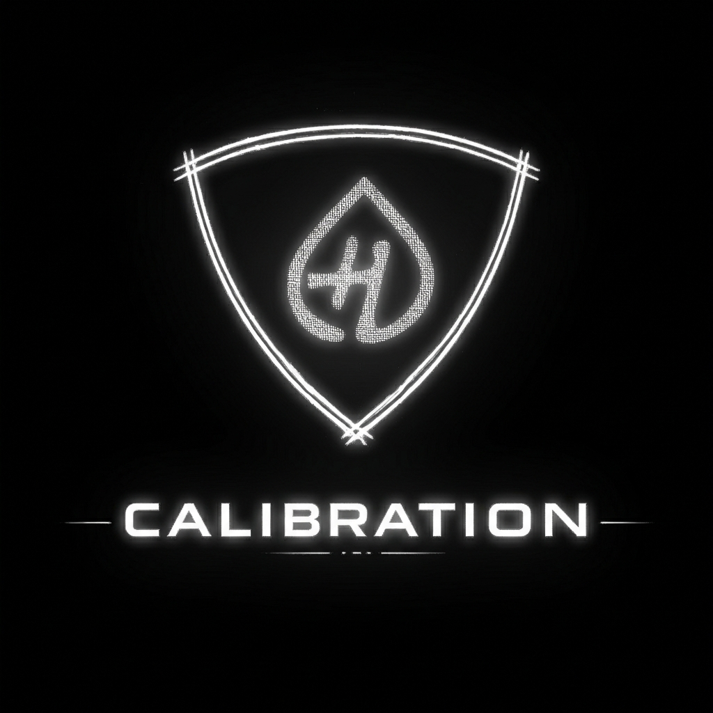
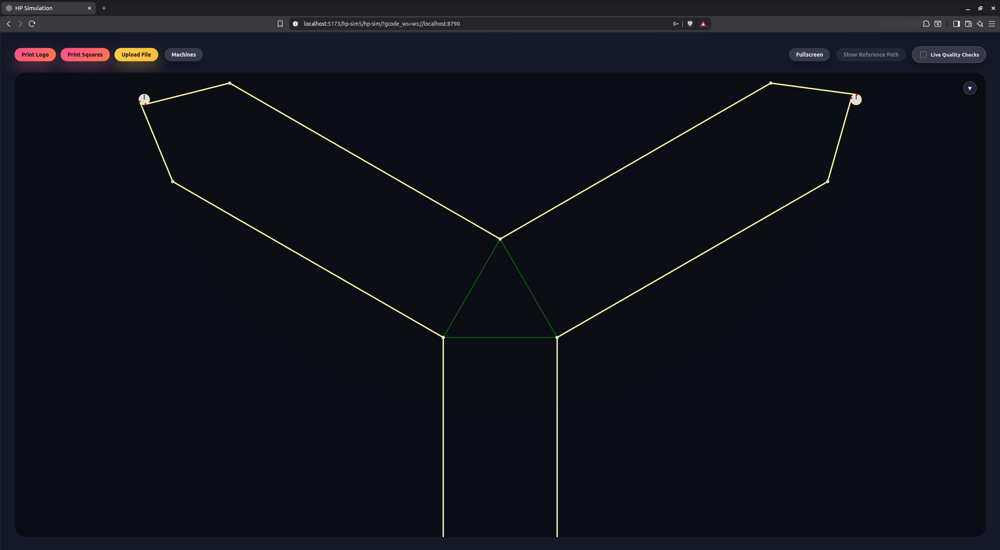
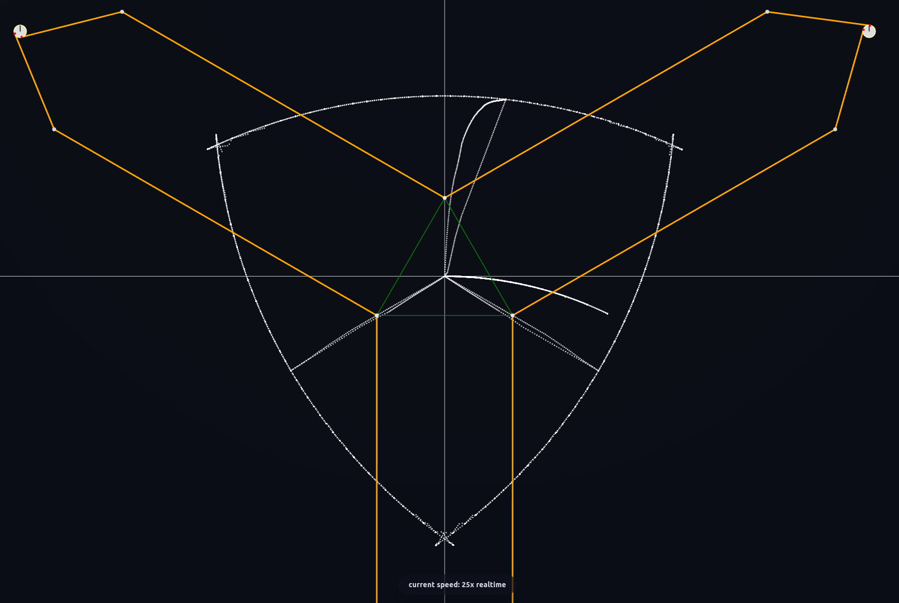

# Autocal



hp-sim5 autocal finds anchor positions and other unknown configuration parameters for overconstrained 3DOF CDPRs.
The basic idea is that a Hangprinter or other CDPR with

 - motor encoders, line odometers or similar line-length-like data, and
 - A torque mode or a force mode that lets motors pull out each others' line via the end effector,

... should be able to "wiggle around a little bit" and through that learn, optimize, or calculate its own calibration parameters.
The user experience is meant to be one-click.
The user should be able to push a button, the machine "wiggles", and is ready to be used once the wiggling is done.
During a sweep, a drive move that leaves measurement preload unchanged uses its
completed encoder quiet check for the next point. The collector keeps fixed-motor
drift checks and all noise samples, and settles again whenever measurement force
changes. This removes a repeated wait without reducing the number of points.
Encoder sampling averages deviations from the first reading, preserving constant
readings exactly and avoiding accumulation error at large unwrapped angles.
The current interface is a terminal call to a Python script. Autocal can reject
inconsistent observations, but smooth mechanical biases can survive with small
fit residuals. The validation report below records measured accuracy and its limits.

It does not retract to the anchors in order to find a stable reference point, as this is often highly impractical with huge CDPRs and heavy, expensive effectors.
The wiggling happens inside the machine's comfortably reachable volume.
It currently works ok for machines with no line buildup, or known buildup (as in "belts instead of lines" type of buildup).
It can handle machines of a very wide range of sizes and such, since it begins by tuning the forces and noise levels.
At least that's the idea. The wide range support code remains to be battle tested.
During development it has only been tested on simulated Hangprinters with 4 and 8 anchors, with and without doubled up gearing for the 4 anchor one.

It's been architected to fit well as a tool for an automated research agent who needs to run autocal experiments on something resembling a physical CDPR.

The code assumes the effector doesn't rotate, so we're talking 3DOF poses, not 6DOF ones.

## The Secret Sauce

Autocal collects sweeps and fits anchor positions to every point's line lengths.
Each point has more lines than the effector has coordinates, so the spare lengths
check that point on its own, and disturbed points are rejected.
It chooses new sweeps by information gain. It can also fit spool radii and buildup.
At final acceptance, it checks saved estimates against sweeps collected after their fit.

On HP3, HP4 and both HP5 variants, new default runs use a per-point sensor force
profile computed from rough anchors, mover weight, strand counts and reeving. Before using
those anchors to set forces, a two-start point fit must pass a local geometry
check: full rank, at least 80% inliers, and at most 25 mm estimated parameter
standard deviation using a 0.5 mm minimum line-error assumption. Weak geometry
triggers additional constant-force sweeps, up to nine; failure stops collection
and preserves `*.rough_bootstrap.json` and `*.rough_bootstrap_checks.json`.
An atomic `*.bootstrap_state.json` marker prevents a restarted command from
using incomplete rough or remeasured data. After interruption or rejection, use
a fresh dataset path after reestablishing the encoder origin; partial evidence
is retained. A complete profiled run can continue only with valid force inputs
and the same force-profile policy; older profiles remain replayable offline.
These are observability checks, not bounds on systematic mechanical errors.
All rough sweeps are then measured again with the checked force profiles; only
the profiled observations enter the refinement fit. Resuming constant-force data
keeps constant-force collection so the two measurement models are never mixed.

Automatic HP3/HP4 planning expands each successfully measured fixed-target range
by one size-tuned excursion. The initial `max_travel_mm` no longer imposes a
permanent travel ceiling or a sum-of-fixed-deltas budget. Planning uses measured
sweeps and fitted geometry. Carrying D remains fixed, and force feasibility,
position tracking, slip and stability checks still apply. Explicit delta bounds
remain available. Planning keeps every predicted position at least 10% of each
anchor's home distance away from that anchor.

The first three nonempty sweeps require measured sensor rewind of half a spindle
turn before taking data. Later points may use a smaller reserve only after a
reversible local encoder-coupling test at their intended measurement force.
Both raw readings and noise means must satisfy the reserve or the tested interval.
Unmeasurable later sweeps return to origin and record boundary evidence so planning
can try another configuration without refitting unchanged data. Rejections consume
the overall budget, not convergence patience. Failed movement or recovery stops
collection; each commanded return is checked before another motor enters force mode.
Coupling tests establish local transmission, not absolute spool occupancy.

Force tables preserve the reeving-aware strain target rather than clamping it to
a minimum force. Infeasible tails are removed, and measurements stay within the
table's support. Commanded profiles do not guarantee actual equal strain: friction,
force tracking and unequal compliance can still bias the observations.

Fresh HP5 and HP5 pulley-reduced runs measure the remaining free low line from
**the first sweep**. Pullout and travel keep the low compliant force, so a line
can visibly sag during those phases. Before recording a measurement, both sensor
lines are preloaded. The spare sensor holds five times the tuned start force,
capped at the tuned maximum. The collector checks its encoder during ordinary
sweep motion. After two consecutive steps with a same-direction response above
the measured noise, the current fifth range enters the fit. A frozen encoder,
a change of direction or a gap in the samples breaks that sequence. Rejected
ranges still contribute their commanded force to the static load model.

HP5 fits use every accepted range with its physical anchor identity, home offset,
reeving and per-pose stretch correction. The default bootstrap uses the rough
anchors to compute the equal-strain force profiles for remeasurement. Candidate
ranking includes future fifth ranges, uncertainty uses the force-aware residual,
and history validation uses all accepted ranges with offsets frozen from each
candidate's training data. HP5 applies the best validated anchor/offset model
rather than averaging it with an unvalidated fit. Historical datasets retain
their collection policy.
`--no-extra-sensors` on the collector retains the legacy compliant-line policy.

HP5 can stop after two successive well-constrained fits with range RMS at most
0.05 mm, estimated maximum anchor standard deviation at most 1 mm, at least four
sweeps and extra ranges accepted on at least half the points. The fits must use
new measurements and agree within 2 mm in every anchor coordinate. The stop reason
is `good-fit`. These checks measure local consistency and observability, not true
anchor error. `--stable-step-mm 0` disables this early condition as well as ordinary
stable-estimate stopping. HP3/HP4 retain their existing stopping rules.

`--fit-home-offsets` is enabled by default. It estimates the non-translational
home-length offsets with the point fit before the anchor fit. Offsets are only
fitted once the data determines them (posterior standard deviation below half the
5 mm prior), and are dropped if they land beyond two prior sigmas or push an
anchor onto its bound. With the first three HP3/HP4 sweeps, which all hold D,
D's offset trades against D's height and is skipped.
Use `--no-fit-home-offsets` and `--no-equal-strain` for ablation comparisons.

The point fit (`pose_fit.py`) is the anchor fit on every Hangprinter. It uses all
ranges, including HP5's extra ones, and the force-aware stretch model, and it
does not need sweeps of any particular shape. It tolerates disturbed data: a
bounded loss limits each point's pull, and points whose misfit exceeds
`REJECT_SCALES` robust scales are dropped and the fit repeated. Each point has
n - d spare ranges, so a line pushed aside or a glitch shows in that point alone.

`--ellipse-reference-fit` fits the anchors with `ellipse_fit.py` instead: each
point's distance in mm to its sweep's predicted drive/sensor ellipse and, on HP5,
to one drive/extra-range ellipse per accepted extra range, after the same stretch
correction, robust loss and point rejection. It needs sweeps with two held lines,
takes held lines at their commanded lengths, and is a reference: the point fit
runs beside it and their difference is logged. Accuracy is within about 0.5 mm of
the point fit on recorded benchmark sweeps, but worse with encoder noise on held
lines, which the ellipse model cannot attribute.

Spool searches (`--find-radii`, `--find-buildup-factor`) on Hangprinters use the
point fit too (`spool_fit.py`): every length is recomputed from the recorded motor
angle with the firmware spool formula, a global radius is profiled on a grid with
the anchors refitted at each value, then radii and anchors are refined jointly.

The 2D slideprinter and retired projected-angle datasets use the legacy ellipse
autocal in `autocal/slideprinter_2d/`, including its own spool search. Each 2D
sweep holds one line, so its circle in the plane constrains the geometry more than
a 3D sweep's circle does; the point fit was clearly worse on the six recorded
slideprinter spool datasets (28-64 vs 5-27 mm summed anchor and radius error on
the same full data), so that package is kept for them only.
`tools/disturb_dataset.py` injects disturbances: the `disturbed_benchmark_*`
regression datasets hold two pushed lines and 3% outliers, and the
`noisy_*mm_benchmark_*` ones Gaussian encoder noise of 0.05, 0.2 and 0.5 mm.
Joint spool/offset fitting is not implemented: spool searches turn offset fitting
off (an explicit `--fit-home-offsets` is an error) and retain constant-force collection. Historical projected
datasets remain replayable, but `--project-zero-tension` collection is retired.

Sweep lengths alone cannot locate physical home under a change of tension.
For HP4 equal-strain collections with free anchor height, the fitter estimates
the change from slack ABC lines at encoder zero to the recorded strand target.
It adds `(strand_tension_n / S) * (home_distance_mm + Y/U)` to each ABC
range and fits the remaining D offset. The home distances come from the fitted
geometry. This approximation assumes negligible initial ABC tension and uses
the configured line stiffness. Collections without a common recorded target
or usable M666 S, Y and U retain the existing offset fit.

For full simulation sanity checks, run `python -m autocal.tools.sanity_battery
OUTPUT --machine hangprinter_3` with `.venv/bin/python`. Use `--stiffness 12000`
or `--scene public/usd_scenes/hp4_worn_bearings.usda` for controlled variants.
It retains provenance and both absolute and translation-aligned anchor errors,
and fails unless normal completion meets `--max-error-mm` (default 1 mm).
The reference is the initial firmware geometry; a changed-geometry scene needs
an independently verified reference.

The [workspace validation report](../research/output/program-2026-11-15-review-and-harden-stretch-insensitive-autocal-robust-bootstrap-h-3fa9855a/validation/workspace-expansion/report.md)
preserves the current full-path trials, actual sampled coverage, recorded-data
ablations and negative results. Passing the coordinate gate in one simulated case
does not establish a hardware accuracy guarantee.

For fast same-data comparisons, use `python -m autocal.tools.compare_fit_replays
FIT_STAGE OUTPUT OPTIONS.json... --reference-m669 REFERENCE.txt --joint`.
Each options file is an explicit JSON override such as
`{"fit_home_offsets":false}` or `{"fit_home_offsets":true}`. Results include
the ellipse fit and production point fit; `--joint` additionally fits raw data
with its own offsets and explicit position variables. It shares neither the
ellipse's length-offset estimates nor its filtering, and is an offline baseline,
not a replacement for production sweep rejection. Frozen historical log
regressions remain in `tools/regress_calibration_logs.py` with their original
no-offset model; matching those references alone does not establish accuracy.

The archived terminal-validation pilot is replayable with
`tools/replay_stage.py terminal`. Its live collection/application option was
removed after mixed accuracy results and review findings about output overrides,
firmware state and interruptions. Offline comparison does not prove physical
accuracy or the freshness of a supplied recording.

## Everyday and research options

Start with ordinary help for routine calibration:

```bash
.venv/bin/python autocal/autocal.py --help
```

It groups machine/model settings, collection and simulator options, and output.
The usage line stays short. Solver budgets, robust filtering, experimental
objectives, movement scoring, run comparisons and diagnostic exports appear in
extended help:

```bash
.venv/bin/python autocal/autocal.py --help-research
```

Both views describe the same parser and defaults. Research options remain directly
usable in normal commands; no extra switch is needed to enable them. The existing
machine aliases and collector forwarding are unchanged. Put `--collector-args`
last because it consumes the remaining arguments.

For replay without new measurements:

```bash
.venv/bin/python autocal/autocal.py --machine-type slideprinter \
  --dataset PATH_TO_SAVED_SWEEPS.json --no-collect
```

Recovery orchestration lives in `fit_recovery.py`: restore filtered sweeps/points,
then optionally seed from an endpoint-preserving sparse subset and refine on the
full data. `stopping.py` owns stable-estimate stopping, uncertainty patience and the
stop-file check. The main loop handles collection and applies the newest fit.

## Python dependencies

The root `requirements.txt` covers the Python dependencies in `autocal/`.

JAX is optional. The default `--optimizer-mode fast` uses it on the CPU.
Autocal falls back to numerical gradients when JAX is unavailable.
Use `--optimizer-mode legacy` to disable the JAX objective.

JAX saves compiled CPU objectives in `output/autocal-jax-cache` for reuse across
launches. Set `JAX_COMPILATION_CACHE_DIR` to choose another directory, or
`JAX_ENABLE_COMPILATION_CACHE=false` to disable disk caching. Explicit user
settings are preserved; in-process JIT reuse also remains active.

JAX 0.9.2 prints a spurious native PJRT compatibility warning on disk-cache hits
([upstream issue](https://github.com/jax-ml/jax/issues/36294)). Autocal defaults
`TF_CPP_MIN_LOG_LEVEL` to `2`, suppressing native C++ INFO and WARNING messages
while retaining errors and Python warnings. Set `TF_CPP_MIN_LOG_LEVEL=1` to
restore native warnings, or `0` for INFO too.

Within each spool/filter pass, repeated exact radius/buildup models reuse up to
16 transformed datasets and their existing residual evaluations. This bounded
cache is discarded after the pass and needs no setting.
Model transformations inside fitting copy length records and configuration,
while borrowing read-only encoder/noise metadata. The public transformation
helper still deep-copies metadata by default.

From the root of the hp-sim5 repo, run:

```bash
.venv/bin/python -m pip install -r autocal/requirements-jax-cpu.txt
```

Check the installed JAX version:

```bash
.venv/bin/python - <<'PYCODE'
import jax
print(jax.__version__)
PYCODE
```


## Quick start (simulation)

Run complete simulated full-auto calibration without a browser:

```bash
.venv/bin/python autocal/autocal.py \
  --headless-sim --machine-type hangprinter_3 \
  --dataset output/headless-trial/sweeps.json
```

`--headless-sim` implies `--sim` and requires the built RRF simulator and Node
dependencies. It starts RRF and the production JavaScript physics/collector in
Node. `hangprinter_3`/`hp3` select the HP3 scene and firmware configuration;
`hangprinter_4`/`hp4` select HP4; `hangprinter_5` and
`hangprinter_5_pulley_reduced` select HP5. Slideprinter, Cubecorners and Skycam
also have scene/config pairs. There is no headless preset for Klipper.

Bootstrap, force autotuning, default point counts/noise sampling, fitting,
adaptive sweep selection and automatic stopping use the existing full-auto
loop. At acceptance, the headless backend applies both M669 and M666. One world
continues across collections and fitting passes. Collector waits advance fixed
physics steps; settling/noise timestamps use simulation time. `--speedup` retains
its collector timing semantics and is independent of Node's wall throughput.

Dataset/replay, fitting, logging, `--no-collect`, `--hp-sim-reset`, configuration
overrides and raw `--collector-args` work as usual. `--hp-sim-reset` resets once
before the first collection. Owned services stop at exit; `--keep-sim-alive`
retains them after a successful run. Explicit `--server` or
`--no-spawn-rrf-simulator` uses an existing RRF service, which autocal does not
stop. Its reported initial/final firmware parameters are captured separately
from the requested configuration file.

The printed `<dataset-stem>.headless/manifest.json` records backend, scene,
baked scene, configuration, RRF and source hashes, service ownership, simulated
and wall time, stopping reason and applied parameters. Repeated invocations
retain numbered artifact directories. Each collector output has an adjacent
`<output>.partial-points.jsonl` with completed measurements and their sweep
configuration/service identity, including on failure or interruption. Partial
journals are evidence; they are not complete datasets or resumable worlds.

Add `--extended-reference` to record physics, Python logs and stage artifacts,
collector commands/replies and measurements in one `.rrd`, without a browser
or live Viewer. Autocal starts and finalizes its own recorder in the headless
artifact directory. An existing recorder can instead be selected with
`--extended-reference-ws URL`. See the
[extended reference guide](data/references/extended-reference.md#headless-full-auto-collection)
for sampling, clocks and ownership.

Verification includes a fresh HP3 global-radius run through normal automatic
acceptance and independent three-sweep Chromium/Node collection with identical
forces/span and the default 10 points per direction (60 points total):

```bash
.venv/bin/python -m pytest autocal/tests/test_headless_sim.py -q -m slow
```

The matched-input comparison allows three RRF reporting quanta (0.03 degrees)
for raw encoders and noise means/deviations, 0.01 mm for collected
lengths/setpoints, and one 2 ms fixed step for sample durations. Timestamps must
be finite and monotonic; absolute timestamp differences are reported separately
because independent settling can cross a quiet-window boundary later.
Force/span selection is held
fixed for parity; independent adaptive autotuning can choose different spans.
The fresh full-auto test separately exercises default autotuning, later sweep
selection, patience stopping, final firmware application and process cleanup.
Automatic completion does not guarantee calibration accuracy: inspect the
solver's reported fit quality and uncertainty.
See [measured verification results](../research/headless-autocal-verification.md).

For autonomous headless HP3/HP4/RRF research, use
[`hp-sim5-research-agent`](../research/README.md) and its `start_collection` MCP
operation. Poll the returned job with `collection_status`.
The launcher supervises firmware and a continuing physics world.
Collection defaults to the production native Rust engine in headless Node.
Collector waits advance simulation time. `--doctor` checks collection and
autocal measurement ingestion. See the [native collection guide](../research/native-collection.md)
for encoder references, force settings and calibration limits.

Follow the root README to start Vite, then open
<http://localhost:5173/hp-sim5/hp-sim-3d/>.

Browser simulation requires a WebSocket connection to the open simulator. Add
`?gcode_ws=ws://localhost:8790` to the simulator URL; for example:
<http://localhost:5173/hp-sim5/hp-sim-3d/?gcode_ws=ws://localhost:8790>.
If the page is missing that parameter, collection waits for the connection and
prints the URL to open.

If you see this, you're good to go:


Initiate simulated full-auto calibration with:

```bash
.venv/bin/python autocal/autocal.py \
  --sim \
  --machine-type slideprinter \
  --speedup 25
```

For a complete recorded browser or headless collection, follow
[extended autocal reference data](data/references/extended-reference.md).
`--extended-reference-ws ws://127.0.0.1:9877` sends timestamped Python and collector
events to the extended flight recorder, alongside physics in one `.rrd`.

`--speedup` is forwarded to the collector.
Use `--collector-args` for other raw collector flags.

Replace `slideprinter` with your machine type: `slideprinter`, `hangprinter_4`,
`hangprinter_5`, `cubecorners`, or `skycam`. The aliases `hp3`, `hp4`, and
`hangprinter_3` currently normalize to `hangprinter_4`.
Keep the hp-sim page visible during calibration.
The browser may pause the simulation when the page is hidden.

If everything went well you should see something like this:


The default working dataset is `autocal/data/default_dataset.json`.
Missing datasets are bootstrapped. Existing datasets with more than three sweeps
are replayed from their first three sweeps in a temporary file.
After replay, the loop can collect new sweeps into the original dataset.

To fit stored data without starting firmware or collecting new sweeps, use an
existing dataset:

```bash
.venv/bin/python autocal/autocal.py \
  --sim --no-collect \
  --machine-type slideprinter \
  --dataset autocal/data/default_dataset.json
```

Patience or a stop threshold can end replay before all stored sweeps are used.
`--no-collect` does not prevent bootstrap if the dataset is missing.

To inspect residuals from the default anchor-only fit, add:

```bash
--residuals-csv autocal/data/default_dataset.residuals.csv
```

Then render a histogram with:

```bash
.venv/bin/python autocal/plot_residual_hist.py \
  autocal/data/default_dataset.residuals.csv \
  --output autocal/data/default_dataset.residuals.png
```

The default spool-fit schedule currently skips residual CSV and report output.
See [the detailed guide](README_elliptical_feature_calibration.md#residuals-and-logs)
for this limitation.

Here's a demo of the autocal loop on a simulated Slideprinter: https://youtu.be/XLmpuAQYbG4


## Independent stage experiments

The one-click loop composes independently callable stages:

| Stage | API | Runs an optimizer? |
| --- | --- | --- |
| Transform encoder observations into modeled lengths | `spool_model.dataset_with_modeled_lengths` | No |
| Fit and assess anchors/spools | `fit_stage.fit_ellipse_dataset` | Yes |
| Plan the next sweep from a frozen fit | `planning_pass.plan_ellipse_sweep` | No |
| Estimate anchor uncertainty in mm | `anchor_uncertainty.plan_anchor_uncertainty_mm` | Yes, one point fit per sweep |

Existing collection backends and inner initialization, refinement, filter-pass
and scale-polish modules remain separate. `plan_next_ellipse_sweep` composes fit
and planning for existing callers. Treat its fit input as a frozen value;
planning options change candidate generation, not anchors or the measurement model.

Add `--stage-artifacts output/stages` to an ordinary run to save versioned JSON
fit snapshots and, at final acceptance, evaluated history. This is opt-in;
normal runs write no stage artifacts. Existing artifact directories get a numbered
sibling so prior trials remain intact. Each snapshot includes sweep data, model
parameters, settings and source hashes. It is data for offline experiments,
not a physics checkpoint. Keep failed trials alongside successful ones.

For example, after a recorded replay produces `fit-001-default.json` and
`history-006.json`:

```bash
.venv/bin/python -m autocal.tools.replay_stage plan \
  output/stages/fit-001-default.json --output output/trial-plan.json
.venv/bin/python -m autocal.tools.replay_stage evaluate \
  output/stages/history-006.json --output output/trial-evaluation.json
.venv/bin/python -m autocal.tools.replay_stage rank \
  output/trial-evaluation.json --output output/trial-selection.json
.venv/bin/python -m autocal.tools.replay_stage fit \
  output/stages/fit-001-default.json --output output/trial-fit.json
```

`--options options.json` overrides saved keyword options for fit, plan or
evaluate, for example `{"candidate_count": 21}` for planning. Fit replay uses
the embedded sweep snapshot and disables plots/residual CSV output. Planning
writes its suggested config beside the output artifact. None of these commands
starts firmware, collects measurements or applies calibration. Stage times
exclude interpreter startup and artifact I/O; measure wall time separately when
comparing commands. A changed ranking policy can be tested against saved
predictions without rerunning optimization or prediction evaluation.

For an inexpensive fixture check, use:

```bash
.venv/bin/python autocal/tools/regress_calibration_logs.py \
  --jobs 2 --dataset-name ten_points_bigger_deltas
```

Then run the full matrix with `--jobs 2`. This bounds concurrency for reproducible
research; the default concurrency and regression acceptance rules are unchanged.
Compare returned parameters and each intermediate fit, not only the aggregate
score. Lower prediction or history scores can still choose worse physical
parameters. These stage boundaries preserve the existing selection policy.

## Typical workflow (real machine)

Remove `--sim` and `--speedup` to use a real machine:

```bash
.venv/bin/python autocal/autocal.py \
  --machine-type slideprinter
```

The loop stops once the estimate stops moving: two consecutive sweeps, each the
planner's most informative candidate, must each move every anchor coordinate by
at most `--stable-step-mm` (0.5 mm; 0 disables). Fit cost is not a progress
measure here, because it rises as sweeps reach harder poses, and expected
information gain shrinks like 1/n without ever reaching a plateau. Stability is
not accuracy: a systematic bias moves no estimate. Three iterations
(`--patience`) without a new lowest anchor uncertainty remain a fallback.
Ctrl-C during the loop accepts the newest fit.

The loop applies the newest admissible fit, which uses all the data. Variants of
one iteration fit the same data, so the lowest cost picks among them (`--shotgun`
specs with different sigma sources do not share an objective); costs of
fits to different data are not compared. The reported quality is the anchor
uncertainty in mm: the largest coordinate standard deviation of point fits that
each leave out one sweep. Up to 1 mm is good, up to 3 mm usable, above that poor.
It misses bias that every sweep shares, such as unmodelled line stretch or wrong
reeving geometry; on HP4 the true error is about 2.7 times the reported value.
For spool fits it also holds the fitted radii fixed, so it misses radius uncertainty.
See `anchor_uncertainty.py` for the evidence.
With `--find-radii` or `--find-buildup-factor`, adding sweeps does not reliably improve the fit, so those runs instead score every saved fit, frozen, on the sweeps that arrived after it, and apply the consensus of the best-predicting fits (`history_selection.py`). A failed or diverged jackknife (above 3 mm and 10 times the lowest so far) is never applied.

Collection checks the latest 1.5 seconds of encoder readings for quiet settling,
with a range limit scaled to the longer 5-second vibration window's drift allowance.
It retains that longer history for the existing vibration check. This reduces
waiting after transients while keeping point counts and automatic stopping.
Sweep pullout searches for an endpoint for up to 120 seconds. If travel has not
settled by then, collection holds the drive and applies sensor preload. The
endpoint and every measurement still require the ordinary settling check;
fixed-anchor slip, stalled clocks and transport errors remain failures.

On acceptance, RRF receives M669 for the selected anchors.
Fitted M666 spool settings are printed but are not sent automatically.
Klipper skips the M669 send.
Reaching `--max-steps` emits and applies the best available calibration, while
the headless manifest records a budget stop rather than normal completion.

Useful options:

- `--dataset` chooses the working dataset.
- `--firmware klipper` selects the Klipper API-mode backend. RRF is the default.
- `--solve-optimizer` accepts `lbfgsb` (default), `lm`, or `trf`.
- `--trf-solver-fallback` optionally retries an unsuccessful or invalid `lbfgsb`
  restart with bounded `trf`. It is off by default: changing the candidate fits
  can worsen the final consensus. `--no-trf-solver-fallback` explicitly disables it.
- `--find-radii` and `--find-buildup-factor` enable spool fitting.
  Each accepts `global` or `per-anchor`. Both default to `off`, turn off home-offset
  fitting and need a constant-force dataset.
- `--sparse-recovery` adds a sparse seed fit during underconstrained recovery.
- `--shotgun` adds solver variants from `shotgun.conf`.


For full details and log interpretation, see
[`README_elliptical_feature_calibration.md`](README_elliptical_feature_calibration.md).
The [algorithm overview](optimization_algorithm_overview) describes the loops.
The [objective overview](objective_functions_overview) explains optimization,
patience, prediction ranking, and displayed quality.

### Anchor solver budgets and diagnostics

`--solve-restarts` sets the multistart budget (default 4). With pointwise filtering,
only the first GNC stage uses that many starts; subsequent stages use one warm
start. `--solve-iterations` defaults to 400, with GNC iteration factors 1, 0.6
and 0.4. Seed and spool-refinement solves apply their own smaller caps. Reducing
these budgets can change the fitted basin; a lower objective does not guarantee
more accurate physical anchors.

Calibration results and frozen fit artifacts retain `solver` and `optimizer_runs`.
L-BFGS-B skips compilation and optimization when the retained point counts make
the minimum sweep count impossible for every anchor geometry. It returns the
same initial anchors and underconstrained sentinel, so recovery and collection
continue through the normal automatic loop.
Full-auto JSONL run entries retain `optimizer_runs` too. Each entry identifies its
GNC stage and zero-based restart, selected restart, resolved method, actual budget, cost, success,
iterations/evaluations, termination message and TRF fallback attempt/use. Costs
across filtering stages or restart-specific masks need not be comparable. The
trace describes the reported anchor calibration, not every nested spool objective
evaluation. Least-squares `nit` uses the backend's Jacobian-evaluation count.

TRF fallback remains disabled by default. When enabled, it retries unsuccessful,
non-finite or geometrically invalid primary results, including a reported
convergence with no valid sweeps. An attempted retry is recorded even if its
result is not chosen. A disabled fallback having zero triggers is not evidence
that the retry capability is unnecessary.

### Noise and filtering controls

`--pointwise-filtering` (enabled by default) uses staged pseudo-Huber loss and a
final 3-MAD hard trim. `--no-pointwise-filtering` uses squared residuals. This
changes both loss shape and trimming; it is not a switch that simply deletes bad
points. The default sweep rejection metric, `outlier_ratio`, needs the pointwise
inlier mask and cannot reject sweeps when pointwise filtering is disabled.

`--sigma-floor-mm` sets a minimum noise-model sigma. Changing it rescales
normalized costs, so compare physical errors and predictions rather than costs
across different floors. Filtering defaults remain unchanged pending validation.

The unused anchor-fit `--threshold` and misleading `--sigma-used-mm` override
have been removed from autocal (including full-auto variants). The unused
threshold in `calibrate.py ellipse` is removed too. Remove these options from
commands and Python fit calls. Old fit-stage artifacts remain replayable: their
saved obsolete options and sigma override metadata are ignored, while explicitly
requesting a removed replay override is rejected. Computed `sigma_used_mm`
diagnostics remain available. The standalone ellipse-fitting API and
`scripts/run_ellipse_calibration_debug.py` retain their working validity threshold.

See [Lane 02 integration evidence](../research/autocal-filtering-lane02-integration.md)
for the bounded checks and remaining model/normalization questions.

### Spool refinement policy

Uniform anchor/radius scale polish runs after every spool filter pass when radii
are fitted, within the configured radius bounds and rank acceptance checks.
The former `--scale-fix` choices have been removed; this is the former default
level 3. The inner spool solve retains its cap of 30 and its tolerance/stall
stopping, so `--spool-inner-iters` has also been removed from the CLI, full-auto
variants and supervisor settings. Remove both flags from existing commands.

Default-valued old stage snapshots (`scale_fix=[3]`, `spool_inner_iters=30`) remain
replayable. Snapshots requesting removed nondefault policies are rejected rather
than replayed with changed semantics. Outer budgets, priors and objective schedules
remain available because their investigations are mixed or incomplete.
See [validation and integration evidence](../research/autocal-spool-lane03-integration.md).

### Planning controls

Use `--candidate-count` (default 41) and `--delta-min`/`--delta-max` for the
candidate grid. A single bound replaces only that side of the machine's default
range. Invalid ranges fail rather than silently changing the requested bounds.
Duplicate exclusion stays enabled, including after the spacing fallback.
`--min-fixed-delta-spacing-mm` still controls novelty spacing.

The information finite-difference step is fixed at 1 mm in the CLI workflow;
the duplicate-key tolerance is 10 mm and the diagnostic shortlist is ten entries.
`--candidate-deltas`, `--fd-eps-mm`, `--no-exclude-existing`, `--existing-tol-mm`
and `--top-k` are removed from the CLI. Independent fit/plan stage APIs retain
research overrides. `--regularization` keeps its 1e-6 default and requires a
finite positive value; the resulting covariance is not calibrated uncertainty.

`--stop-cost` and `--stop-std-mm` are removed. Patience stays at 3 as a fallback
to the `--stable-step-mm` stop.

### Ellipsoid autocal (sphere meshes)

`--collection-shape mesh` (default `sweep`) runs a separate Hangprinter autocal,
`ellipsoid_autocal.py`, that neither plans from a model nor uses the point fit.

A mesh holds one line (D, or the top line on HP5) at one length, so the effector
stays on a sphere around that anchor. Each row also holds one more line, the
level line, and is an ordinary force sweep: the drive pulls out in force mode
until it stalls, then steps back to its start with the sensor in force mode. The
rows of a mesh hold each free line as level line in turn, with five points per
direction (30 points per HP4 mesh, 40 on HP5). Held and level lengths follow a
fixed schedule of fractions of the travel measured while the first mesh is
size-tuned, so the collector finds every reachable range itself. The collector
takes one held length per row from the sweep config file (`[0,3] 1 2 fixed=430,-215`).
A row it cannot measure after the first mesh is recorded as a rejection and the
rest of the mesh is kept.

The anchors come from `ellipse_fit.py` alone. Every point of a mesh lies on one
ellipsoid in squared-length space; points are grouped by which lines they
measured, so HP5 rows with and without an accepted spare range both count. The
fit also estimates home offsets with the point fit's prior and guards: offsets of
0.2 mm cost about 16 mm of anchor error when ignored. After each mesh the fit is
repeated from the blind seed (at 1x, 2x and 4x scale, since the seed
underestimates the anchor distances and HP5 otherwise settles two metres off)
and from the previous fit; the lowest rms wins. Line stretch is corrected at
the recorded constant forces, also on HP3/HP4, whose point fit leaves stretch to
equal-strain collection; without it the HP3/HP4 meshes end 1.2-2.2 mm off. The
run stops when two consecutive meshes move no anchor coordinate by more than
`--stable-step-mm` (after at least three meshes), when the stop file appears,
after the eighth mesh, or when a collection fails after three meshes (the fit
so far is kept).
The reported uncertainty is the largest anchor shift when one row is left
out. `--no-collect` replays a dataset mesh by mesh; sweeps of older datasets that
hold the same line at the same length are treated as one sphere.

## Headless benchmark history

CI runs fast tests, slow integration tests, and the four autocal benchmarks in
parallel. A benchmark job skips simulator setup when its inputs match its
parent and CI already has a successful run under the same settings, scorer,
and benchmark harness. Changes to the benchmark test, package scripts, or CI
workflow also trigger a fresh run.
Local backfills and CI use a 4.5 million physics step cap by default.

Default-branch CI publishes `results.jsonl`, `summary.md`, and `by-fingerprint.md`
at the root of the `benchmark-history` branch. The JSONL file retains individual measurements,
wall times where available, run IDs, and failures. Wall time depends on runner
load and hardware. `summary.md` groups repeats by tested commit
so it shows reversions. `by-fingerprint.md` groups runs on identical inputs across
commits. Both show medians and counts. CI flags a simulated-time increase above
5%, loss of convergence, an anchor coordinate error increase above the greater
of 0.2 mm and 10%, or a maximum error crossing above 1 mm. CI compares with the
nearest comparable measured first-parent revision. Each branch gets a job
summary. When the only available baseline used a different or unknown benchmark
protocol, the summary labels the comparison exploratory. The artifact retains
the simulator and calibration logs and the headless manifest, including for failed
runs that reached the simulator. A calibration crash, timeout,
or failure to apply parameters still fails the benchmark job.

Use matched repeats to investigate a flag. Run the same machine three times
on each revision under the same local environment and scorer, then compare
their medians. Increase the sample count if the result is still ambiguous.

```bash
.venv/bin/python scripts/autocal_benchmark_backfill.py \
  --revs OLD_SHA NEW_SHA --machines hangprinter_4 --repeat 3
git add output/autocal-benchmark-backfill/results.jsonl
```

Commit the results file directly. CI reads it when the commit reaches the
default branch, verifies the recorded fingerprints, and adds the observations
to the history branch. The default output directory also allows committing
`retry.jsonl` if a legacy backfill produced it. Logs, caches, and generated
summaries stay ignored. Reprocessing the same data keeps each observation once.

Version 1 fingerprints from existing backfills remain valid for import. New runs
use version 2, which includes the machine catalog, referenced scenes and
firmware configs, the legacy transform, and dependency declarations. The
runner selects new work using version 2, so a historical scan can remeasure
inputs covered only by version 1. Each new measurement records the installed
Python and Node environments and hashes the scorer with its local Python
dependencies.
