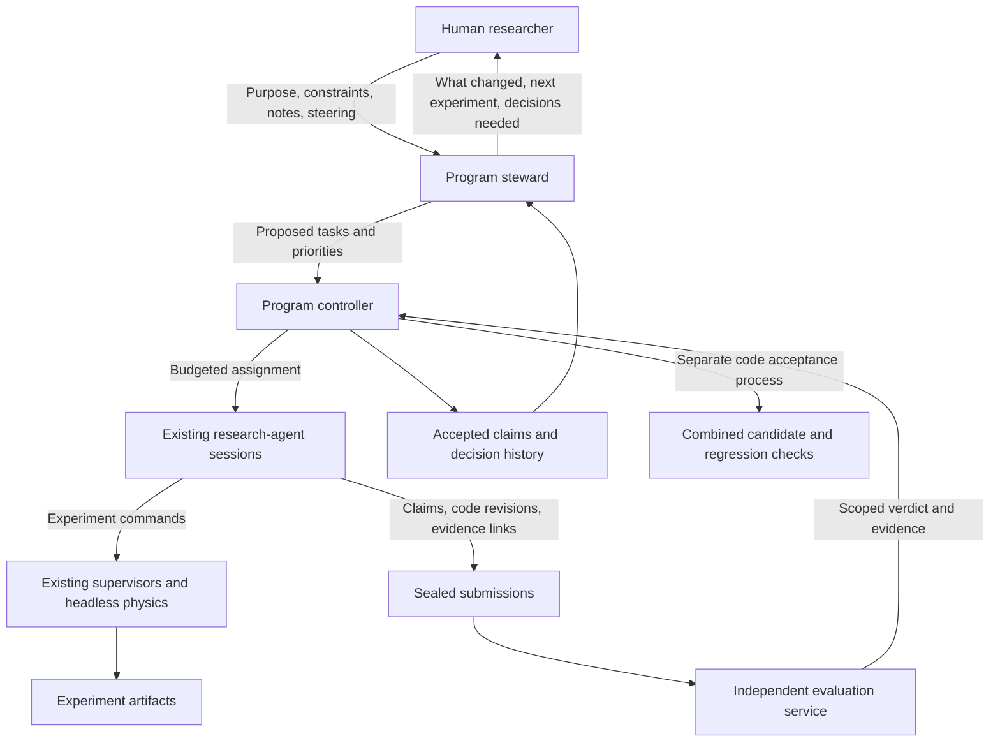

# A research program above hp-sim5-research-agent

Design proposal, 23 October 2026. Based on checkout `b39fa16faec8`, the
published "Hand Cranking the Development Engine" post, and the sources linked
below. No new numerical experiments were run. Proposed commands and files in
this document are not implemented interfaces.

Implementation follows the [one-task backlog](research/program-tasks/README.md).
Tasks 001–006 completed the evidence/prompt/handoff foundations. The user has now
authorized the chat-driven manager, graph memory, approach selection and worker
orchestration in tasks 007–016. The [manager release contract](research/program-tasks/MANAGER.md)
defines current required scope and completion; the sections below retain the
original design rationale. Where they suggest deferring chat/graph/controller
work or routinely duplicating evaluation, the current contract and evidence-first
review policy take precedence. Target command names below remain proposals until
their implementation task ships.

The next useful abstraction is a **research program**: a continuing set of
questions, evidence, competing approaches and decisions, pursued within a
human-defined purpose and budget. An hp-sim5-research-agent session remains the
place where a researcher investigates one bounded question. A program steward
decides which investigation is worth doing next. A small controller owns
execution, resource accounting and state transitions. An independent evaluation
service determines which submitted claims meet the program's evidence contract.

The intended human experience is: give the program a question and constraints,
then receive a short account of what changed our understanding, what remains
uncertain, and which decision deserves human attention next.

## What transfers from Ralph and FrenzyMath

Ralph's useful ingredients are bounded work, durable progress and fast feedback.
Pocock's guide uses a task list, one task per invocation, commits, and a finite
loop. The fresh start is a context-management choice. It does not itself select
good scientific questions or establish whether a result is true.
[Pocock, Getting Started With Ralph](https://www.aihero.dev/getting-started-with-ralph),
[Huntley, Ralph Wiggum as a software engineer](https://ghuntley.com/ralph/).

Iteris adds a changing task pool, durable research state and distinct research
modes. Its exploration agent probes alternatives before the planner selects
work. Its README distinguishes generalizing one result through `evolve` from
coordinating related original problems through `family`. These are useful
precedents for branch selection and sharing evidence across Hangprinter
questions. [Iteris design post](https://frenzymath.com/blog/iteris/),
[Iteris README](https://github.com/frenzymath/iteris/blob/main/README.md).

These projects form overlapping lines of work. Danus explicitly reuses Rethlas's
worker-verifier core; Pharos inherits that core and the fact graph from Danus.
The inspected sources do not establish a direct Iteris-to-Danus succession.
Danus also has a `codex` branch, described as v3, where the main agent reasons
directly without the original external strategy-consult step. That is an
architectural variant, not an isolated measurement of its benefit.
[Danus README](https://github.com/frenzymath/Danus/blob/main/README.md),
[Danus v3](https://github.com/frenzymath/Danus/blob/codex/README.md).

The reported Iteris successes also required human verification and correction.
In particular, the authors describe repairing an unsupported rate claim.
That is a reason to preserve expert intervention and claim limits in this
design. [Chen et al., Iteris](https://arxiv.org/html/2606.02484v1).

FrenzyMath's newer Pharos is an especially close comparison. It describes a main
agent, a route board, continuing workers, helpers and fresh verifier sessions.
Accepted submissions enter a shared fact graph. Its documentation explicitly
states that model verification is not a formal certificate, and that MCP role
permissions do not restrict direct filesystem access by the agent processes.
Borrow the separation of roles while making the actual isolation boundary
explicit. [Pharos architecture](https://github.com/frenzymath/Pharos/blob/main/docs/architecture.md),
[Pharos announcement, 7 October 2026](https://frenzymath.com/news/pharos-preview/).

Two related formalization projects supply useful ideas too. Archon Horizon is
described as a complementary alternative to Archon, coordinating objectives and
missions across projects and machines. SHEAF works backwards from locked targets
and prunes unused dependencies. These suggest a useful separation between the
graph of available knowledge and the much smaller dependency set needed for the
next decision. [Archon Horizon](https://github.com/frenzymath/Archon-Horizon),
[SHEAF](https://github.com/frenzymath/SHEAF).

Anthropic's harness work also supports small tasks and durable handoffs, and
its later planner/generator/evaluator design separates construction from
assessment. These are engineering precedents; they do not establish that this
architecture will improve Hangprinter research. That needs a local trial.
[Long-running agents](https://www.anthropic.com/research/effective-harnesses-for-long-running-agents),
[Harness design for long-running applications](https://www.anthropic.com/research/harness-design-long-running-apps).

## Preserve the existing worker

The [execution architecture](research/architecture.md) already separates the
conversation from physics, firmware, asynchronous jobs and recordings. The
[launcher](scripts/research_agent.py) already supports interactive, batch,
service-only and worktree routes. The [research instructions](research/AGENTS.md)
already require hypotheses, budgets, evidence, negative results and searchable
reports. Reuse those contracts.

The missing information is mostly between sessions: why this question outranks
another, which claims another result depends on, whether several failed attempts
have exhausted a direction, and whether individually useful changes remain
useful when combined.

The research instructions protect ordinary conversation continuation from
redundant restart machinery and now explicitly permit the manager to dispatch
distinct bounded investigations and reviews through the existing launcher. A
program controller must not repeatedly restart a worker merely to push the same
unfinished prompt forward. The manager implementation is tracked in tasks 007–016.

## Responsibilities and authority

| Responsibility | Owner | Authority |
| --- | --- | --- |
| Set purpose and acceptable tradeoffs | Human | Revise the program charter and delegated authority |
| Identify gaps, rank routes, prepare briefs | Steward agent | Propose and schedule within the charter; cannot certify its own conclusions |
| Lease tasks, launch jobs, account for budgets, recover | Ordinary controller code | Enforce permitted transitions and resource limits |
| Investigate, run experiments, improve tools, propose patches | Existing research worker | Write its workspace and submit results; cannot accept its own claims |
| Reproduce measurements and assess claim scope | Evaluation service, with model review where useful | Issue versioned acceptance, rejection or inconclusive verdicts |
| Combine patches and check interactions | Integration job | Prepare a tested combined candidate under the charter's merge policy |

Start with one steward and one worker. Source scouting, strategic review and
tooling diagnosis can be temporary assignments. Each extra permanent agent
should earn its cost in a measured trial.

The program controller is separate from today's physics supervisor. The latter
continues owning its world's services and jobs. The controller supervises whole
research assignments and must stop their owned jobs when cancelling them.

## Represent questions, work and knowledge separately

A single task list cannot say both what happened and what we now believe.
Maintain a work board and a claim ledger, connected by stable IDs and evidence
links. Simple relations suffice; no graph database is needed.

| Record | Minimum useful contents |
| --- | --- |
| Program | Human purpose, operating envelope, important metrics, constraints, budget, authority and charter version |
| Question or route | Why it matters, competing explanations, supporting and conflicting claims, present obstacle, next discriminating test |
| Work item | One decision to inform, inputs, allowed scope, expected observations under alternatives, maximum cost, stopping rule, result contract |
| Attempt | Worker/session ID, base revision, environment, reserved and consumed resources, job IDs, artifacts, terminal outcome |
| Claim | Exact statement, applicability, evidence type, source/input revisions, assumptions, dependency IDs, review ID and current status |
| Decision | Continue, branch, park, retire, integrate or ask the human; rationale and evidence available at that time |

An example claim is "On these simulated HP3 configurations, method A predicts
unseen sweeps better than method B under this collection budget." It is not
"A fixes calibration." Keep evidence type explicit: simulation, synthetic
construction, analytic argument, reference implementation or hardware.
Acceptance means sufficient evidence for that statement under a named contract.

Claims can support, contradict or limit other claims. Questions can share
dependencies across families. An HP3 result can suggest an HP4 experiment without
becoming an HP4 fact. Preserve the parameter ranges, coordinate conventions and
data provenance that govern reuse. The recent
[nominal-truth integration review](research/autocal-solver-lane01-integration.md)
is a useful local reminder to check what a reference actually represents.

If a claim is retracted, mark dependent conclusions for review and prevent them
from silently serving as accepted premises. If the simulator changes, retain
the old result's original scope and flag its applicability to the new revision
as unestablished. Changed circumstances do not erase historical measurements.

Existing reports stay where they are. The ledger indexes their precise claims
and review state. Seed it selectively from relevant reports, with provenance;
do not automatically label the entire existing corpus as independently accepted.

## Make the claim ledger an evidence graph

Yes, a knowledge graph makes sense here. The ledger above is already its minimal
form: individually addressable claims connected to evidence, assumptions and
other claims. The useful capability is answering which result supports a
decision, which conditions govern reuse, and what needs reconsideration when an
input becomes suspect.

Danus and Pharos do not require a graph database for their fact graphs. Their
implementations store Markdown fact files with predecessor IDs and support
search and descendant traversal. Pharos also caches BM25 search data. Graph
semantics and admission rules are the transferable design choices.
[Danus fact storage](https://github.com/frenzymath/Danus/blob/1a2cb99f9b16abb6b82d1bda207ed8a822f12743/danus/core/factgraph.py),
[Pharos fact storage](https://github.com/frenzymath/Pharos/blob/aa0b72e4a7211311a3156ef7d993cd3be9f57445/pharos/core/factgraph.py).

### Separate provenance, evidence and research direction

Use shared IDs with three sets of relations:

| Relations | Examples | Structural rule |
| --- | --- | --- |
| Provenance and derivation | Run used scene; measurement came from run; analysis used dataset; conclusion required specified premises | Acyclic for immutable versions; reject structural dependency cycles |
| Evidential relationships | Supports, challenges, independently reproduces, limits applicability, supersedes | No general DAG restriction; the relation does not automatically imply logical entailment |
| Research direction | Question motivates route; experiment distinguishes hypotheses; finding changes decision | Record decisions over time; revisiting a question is legitimate |

Acyclicity prevents recorded dependency loops. It cannot detect an undeclared
circular argument, establish that a measurement is valid, or turn empirical
support into proof. Keep those responsibilities in evaluation.

An accepted simulation result can support a bounded empirical statement without
settling a general physical claim. Record simulation, synthetic, analytic,
reference-implementation and hardware evidence as distinct kinds. Record
independent reproduction separately from the original evaluation status.

An experiment's failure to support one explanation does not establish its
competitor. A solver failure also differs from a counterexample. Preserve those
distinctions in relationship types and review reasons, not only in report prose.

### Minimum record shapes

| Record | Fields that matter for reuse |
| --- | --- |
| Claim version | Exact statement, scope, units, assumptions, uncertainty and limitations; immutable identity |
| Artifact | Content digest, artifact location, source revision, world/job IDs, scene and firmware configuration, backend, dataset provenance |
| Analysis or derivation | Required premises and evidence artifacts, analysis revision, measurement definition and resulting claim |
| Assessment | Claim/derivation IDs, evaluator and contract version, actual checks, verdict and reasons; append a new assessment when reevaluating |
| Research link | Question, alternative explanation, proposed discriminating observation, maximum cost and the decision each outcome would inform |

Do not copy telemetry samples into graph nodes. Keep large datasets, RRDs,
figures and reports as artifacts and link to the relevant measurements. Extract
candidate claims from reports, but require review before using their acceptance
status as an authoritative premise. Existing full-text and abstract search
remain useful for finding material that has not been modeled.

Semantic content includes reference versions and inputs that affect the result.
Cosmetic citation formatting can be editable metadata. Changing the referenced
theorem, dataset or measurement convention requires a new scientific record.
Content hashes identify exact records; they do not identify all logically
equivalent claims or establish independence of two supporting analyses.

### Represent alternative support explicitly

An empirical claim may have several independently sufficient arguments or
measurements. Give each derivation its own node. Within a derivation, all required
premises must hold; across alternative sufficient derivations, one can survive
another's withdrawal. This avoids invalidating every conclusion merely because
one supporting experiment is found faulty.

When evidence is withdrawn, compute the affected derivations, suspend unsupported
acceptance and queue review. Preserve artifacts, earlier verdicts and the reason
for the change. When only the operating envelope or simulator revision changes,
mark applicability to that new context as unestablished instead of retracting
the old measurement. Shared datasets, equations and engines must remain visible
so multiple records cannot masquerade as independent evidence.

The controller, not the worker, owns authoritative admission and status changes.
A worker submits a claim and links; an evaluator assesses the stated derivation;
the controller records the result. Speculative findings, extracted literature
claims and human hunches remain discoverable without becoming accepted empirical
premises automatically.

### Choose useful granularity and test the graph's value

Pharos's worker contract explicitly asks for substantial results rather than
routine deductions split into many facts. It also starts fresh agent sessions
each round and preserves the investigation through local files and shared stores.
Thus its continuity is a continuing investigation, not necessarily a continuing
conversation. hp-sim5 should preserve its existing conversation workflow unless
a local comparison justifies changing it.
[Pharos worker contract](https://github.com/frenzymath/Pharos/blob/aa0b72e4a7211311a3156ef7d993cd3be9f57445/agents/contracts/worker.md).

For this repo, start with one claim per reusable finding: a demonstrated
regression mechanism, a measured tradeoff, a useful negative result or an
identified ambiguity. A graph node is not owed for every experiment or turn.

Pilot the graph with roughly 10-20 candidate claims from a few related sessions,
including negative and incomplete investigations. Compare it against ordinary
catalog and report search on concrete tasks:

- Reconstruct the evidence and limits behind a proposed default change.
- Find whether an HP3 finding has actually been tested on HP4 or hardware.
- Identify which conclusions need review after a reference or measurement bug.
- Expose two live explanations and the smallest credible observation that would
  change their treatment.

Measure answer accuracy, sources inspected, missed qualifications and human
handling time. A graph that merely produces attractive diagrams has not earned
the cost of maintaining it. The initial SQLite controller can represent nodes,
typed edges, derivations and assessment events; graph infrastructure can wait
until actual query workloads justify it.

## Pull one decision-sized investigation at a time

The work board can use:

`proposed -> ready -> running -> submitted -> reviewed -> closed`

Keep scientific outcome separate: supported, rejected, mixed, inconclusive or
not tested. A rejected hypothesis can close a successful work item. A crashed
or blocked experiment cannot reject its hypothesis. Code disposition is another
field: no patch, candidate, integration pending, integrated or discarded.

After a verdict, the steward revises the available work. A surprising result can
replace the next experiment; a negative result can retire a route. There is no
requirement to finish an initial backlog. The local execution contract is
structured, while the global research agenda remains revisable.

An iteration should:

1. Reconcile live attempts and jobs; ingest new human steering and review results.
2. Identify the decision most worth informing with the remaining budget.
3. Select a ready work item with valid inputs and a usable evaluation route.
4. Reserve its experiment and evaluation resources, then lease it to a worker.
5. Let the worker investigate within that scope, preserving its conversation.
6. Seal its submission; independently evaluate it at the fixed revision.
7. Record the scoped verdict, update dependencies and make the next decision.

The controller validates leases and transitions. A worker's final message,
successful exit, or `COMPLETE` token is a submission signal, never authority to
accept a claim or declare the program successful.

Fresh contexts are useful for a new task or an independent review. Keep a
productive investigation in its existing conversation across turns and client
compaction. A replacement worker receives a handoff with hypothesis, observations,
open objections and exact artifacts. Conversation resume does not restore a
physics world, as the current launcher documentation explains.

## Make evaluation independent in authority

Workers should freely inspect evidence, critique their results and run public
development checks. That feedback improves experiments. What must be outside
their control is the acceptance decision, its governing contract, and any
protected evaluation inputs.

Use three layers:

| Layer | Purpose | Feedback |
| --- | --- | --- |
| Development checks | Fast iteration and debugging | Full tests, cases and measurements available to workers |
| Independent acceptance | Reproduction and assessment on a fixed submission | Scoped verdict, measurements and useful failure explanations; protected cases handled according to the contract |
| Scientific judgment | Whether the question, model and evidence justify the engineering decision | Periodic human review, supported by skeptical agent review and external evidence |

Acceptance has separate questions: is the experiment valid, does the evidence
support this claim, is the result useful under the charter, and is its patch
fit to integrate? Passing tests answers only part of this. An accurate negative
result may be worth retaining with no code change. A useful algorithm may still
need a maintainability fix before merging.

Report the primary outcome alongside guardrails such as prediction error,
parameter error where truth is known, collection time, force limits and failure
rate, as relevant to the question. Set meaningful tolerances before comparison
and retain uncertainty. A fitting-score gain cannot compensate automatically for
a guardrail failure. Keep alternatives with different useful tradeoffs visible;
the charter determines which tradeoffs are delegated and which need human judgment.

For a patch submission, record the base and candidate revisions, relevant diff,
data and scene hashes, commands, environment, measurement definition, requested
claim and known limitations. The evaluator re-executes important measurements;
reading the report alone is insufficient. The code tested must be the sealed
candidate, and subsequent edits require a new submission.

Run baseline and candidate under the same declared conditions. Freeze the
measurement harness and acceptance thresholds independently of the candidate.
Candidate tests are additional evidence and cannot replace required checks.
If evaluation code needs improvement, submit that as a separate change, review
it against known good and bad cases, version the contract, and rerun both
baseline and candidate. Do not silently move the criterion after observing a
result.

### Enforce the boundary where the processes run

A private reviewer prompt is useful for independent criticism, but secrecy is
not the architecture. Criteria should usually be visible. Protected seeds,
hardware datasets or release cases can reduce adaptation to particular tests.
Repeated querying still leaks information, so reserve a final confirmation set
and record acceptance queries. Exposed cases become development evidence.

Today's launcher shares `output/`, dependencies and other runtime paths between
worktrees. The research sandbox also permits writing shared output. A separate
worktree therefore provides code organization, not evaluator isolation.
[Launcher worktree implementation](scripts/research_agent.py),
[worktree contract](research/README.md#research-in-a-git-worktree).

For unattended acceptance, run the controller and evaluator outside the worker's
write permissions. Workers submit through a narrow interface; the controller
copies artifacts into its own immutable submission store. Merely hashing a file
that the worker can overwrite is insufficient. Give workers read-only access to
accepted evidence and write access to their own attempts. Do not share private
evaluation directories, mutable dependencies, controller credentials or writable
Git metadata into worker environments.

Use a separate OS identity or appropriately isolated container/runner. A
container with writable controller mounts does not establish this boundary.
Worktrees share Git administration, so protect canonical refs separately too.
Execute candidate code in a child sandbox with read-only evaluation inputs and
no authority to write verdicts or change the harness. The trusted runner computes
the measurements and records the verdict outside that sandbox. Avoid trusting
candidate-produced score files without independent checking.

One model family can serve both worker and reviewer roles. Separate contexts
reduce some biases but do not guarantee independent reasoning. Stronger evidence
comes from independent measurements, analytic cases, implementations with
different failure modes, varied configurations and hardware observations.

There is no need for an infinite tower of evaluators. A fixed evaluation version
has human authority for a stated scope. Meta-research can propose replacing it,
but cannot accept its own replacement or rewrite old verdicts. The remaining
uncertainty is explicit and revisitable.

### Treat the simulator as a scientific instrument

When testing a calibration algorithm, hold the simulated physical world fixed
and prevent the algorithm from using ground truth unavailable on hardware.
When improving simulator physics, evaluate the instrument itself using relevant
analytic limits, invariants, reference implementations and hardware evidence
where available. Agreement between backends sharing an equation does not
establish that the equation describes the physical machine.

Do not simultaneously alter the simulator and calibrator and attribute the
result to one of them. First qualify the instrument change, then rerun the
algorithm comparison, or use an explicitly designed factorial comparison.

The mandatory `npm run test:physics` remains a blocking delivery gate for physics,
motors, cable transport and scene dynamics changes. Its Print Logo and settling
checks establish particular stability properties. They do not establish
calibration accuracy or hardware transfer.

Evaluate combined patches as a new candidate. Individually accepted changes can
interact. Keep research acceptance, the combined regression result and the
charter's merge authority as distinct records.

## Choose experiments by the decisions they could change

"What important things about Hangprinter do we still not understand?" should
produce a provisional map of consequential uncertainties, grounded in the corpus,
literature and human context. It cannot promise an exhaustive list of unknowns.
Each entry needs a reason it matters, competing explanations, existing evidence,
and the cheapest credible way to distinguish those explanations.

Before launching an experiment, ask what observation would cause a different
action. If every plausible outcome recommends the same action, either the
experiment is unnecessary or its decision has not been stated clearly enough.
Basic measurement development can itself be the required action when nothing
can yet discriminate the hypotheses.

Rank candidates using consequence, discriminating power, credibility of the
measurement and total cost. Cost includes researcher attention, setup, analysis,
reproduction, compute, movement and hardware wear. Use qualitative ranges first.
Invented probabilities and a precise-looking value-of-information score would
hide the judgment this is meant to expose. Formal expected decision value is
useful only where utilities and probabilities have a defensible interpretation.

The cheapest credible experiment may be a saved-data replay, a source audit or
a physical measurement. Simulation may be unable to distinguish explanations
whose difference is a phenomenon absent from the model. Say so and prepare the
smallest useful hardware protocol within the human's allowed scope.

For example, a proposed first question is whether disagreement among fitted
geometries diagnoses poor identifiability or model mismatch. This is a suggested
research direction, not a new finding:

| Alternative | Cheap first probe | Consequence |
| --- | --- | --- |
| Inadequate excitation in otherwise adequate models | Search saved candidate histories for equally predictive, geometrically different fits; predict where their observable responses diverge | Test a small targeted movement before collecting a large new dataset |
| Systematic winding or force-model mismatch | Check whether residual patterns persist across distinct fits and excitation changes; compare controlled mismatch cases | Investigate the instrument/model before expanding solver search |
| Selection rule chooses poorly among adequate fits | Replay selection with fixed candidates and collection inputs | Isolate ranking work from collection and fitting |

These probes narrow alternatives; one residual pattern does not identify a
unique cause. For a proposed movement, require predicted observable separation
large enough relative to measurement noise and model uncertainty. Otherwise
recommend a better measurement, retain ambiguity, or stop. Do not fabricate a
decisive experiment from geometrical disagreement alone.

A bounded independent scout can periodically challenge the steward's agenda,
retrieve outside methods and propose a competing route. Following Iteris's
precedent, its output is advice; it does not certify findings. Reserve a small
explicit exploration allocation so easy parameter improvements cannot consume
the entire program. The human can redirect that allocation without rebuilding
the board.

## Budgets and recovery belong in ordinary code

Prompted budgets express intent. Enforced budgets require the process or tool
owner to measure consumption and refuse further work.

Track wall deadline, worker concurrency, CPU/GPU allocation, experiment count,
simulated movement/time, storage, model usage where exposed, and human attention
separately. Subscription usage may not have a meaningful dollar meter. Distinguish
measured usage, estimates and hard limits rather than labelling them all cost.

Reserve resources before dispatch, including an evaluation allowance. Child
assignments draw from the parent program. Park work when it cannot be evaluated;
otherwise workers can spend the whole budget producing an unreviewable pile.
Limit work awaiting review as well as running workers.

A process controller can enforce wall time and resource ceilings. Movement
limits belong in the experiment supervisor/backend. Shell-launched experiments
need the same accounting or an explicitly weaker guarantee. Do not advertise a
hard movement or spend cap when the agent can bypass its meter. Begin local;
select remote compute only when capability or measured throughput warrants it.

Use leases, heartbeats and attempt IDs. On restart, reconcile actual agent
processes and owned experiment jobs before making a task ready again. Preserve
partial evidence and mark an interrupted attempt accurately. Retry infrastructure
failures within a bounded retry allocation; do not relabel them as failed
hypotheses. Resume only after establishing whether the old world remains alive
or a fresh world is needed.

Pausing dispatch, interrupting a conversation and cancelling experiments are
different actions. A program stop must reach child supervisors, cancel their
jobs, preserve partial evidence and report the actual boundary. Existing
`cancel_collection`, `cancel_autocal` and `cancel_test` are the starting contracts.

Stop a bounded allocation when its decision is answered, its budget expires,
the evaluation path is unavailable, or a predeclared futility rule applies.
Repeated inconclusive probes should trigger reframing, measurement work or
parking, according to that rule. A long-lived program can remain open with no
currently funded work. An empty board does not mean Hangprinter is understood.

## Preserve the human's broad context without demanding a second job

Let the human drop a note, paper, URL, conversation excerpt, physical observation
or hunch into a program inbox. Preserve the original words and provenance. The
steward links it to questions and proposes consequences. A hunch can reprioritize
research without becoming an established empirical claim.

Explicit steering updates the charter or assignments within the human's stated
authority. A scratch note or exploratory chat is context until the human
expresses intent to act on it. Keep those semantics visible, so an informal
conversation cannot silently rewrite the program. Capture enough context for the
next decision; a complete digital model of the human is unnecessary.

The primary interface is a brief, with links for drilling down:

- What changed our understanding, with the strongest evidence and its limits.
- Which important alternative remains live, and why it matters.
- The next cheapest credible experiment, its maximum cost and possible decisions.
- Actual resources consumed, evaluation still outstanding and infrastructure trouble.
- Any decision requiring human context or a change in delegated authority.

If everything remains inside the charter, continue and provide a digest. Ask at
meaningful boundaries: an engineering tradeoff not covered by the charter, a
budget increase, a physical experiment requiring participation, a contested
evaluation contract, or a question whose importance depends on missing human
context. Do not ask the human to choose routine worktree names or recording modes.

## Build milestones with observable acceptance criteria

| Milestone | Small deliverable | Evidence required before expanding |
| --- | --- | --- |
| 1. Define one program and its evaluation contract | Charter, question cards, submission/verdict format, manually operated independent review | An existing strong result and a known flawed or overclaimed result receive appropriately scoped verdicts; worker output alone cannot become accepted knowledge |
| 2. Complete one managed investigation | Controller leases one item, invokes the existing launcher, seals the submission, requests evaluation and writes a brief | End-to-end provenance works; an interrupted run preserves evidence and cannot create a false success; evaluation files resist worker writes at the claimed isolation level |
| 3. Run a bounded pull queue | Mutable board, resource reservations, retry/futility limits and review backlog limit; initially one worker | Several successive investigations change the next choice based on evidence; budget stop cancels owned jobs; negative results close useful tasks; a fresh steward recovers from durable records |
| 4. Coordinate related investigations | Small concurrent worker pool, explicit shared claims, protected artifacts, integration candidate | No duplicate leases or shared-world interference; family results retain scope; contradictory claims remain visible; individually passing patches are checked together |
| 5. Delegate agenda formation | Corpus/literature scouts, route reviews, uncertainty map and proposals for cheap discriminating experiments | Compared with human-led selection on recorded and live pilot questions, the program reduces human handling while producing useful decisions; repeated review does not merely add prose |
| 6. Improve the research apparatus | Tooling and evaluation proposals enter the same bounded work system | Each adopted tool change demonstrates reproducibility, saved effort or a new measurement capability; evaluator changes pass external review and do not retroactively upgrade prior results |

Milestone 1 should replay known failures too: better fitting score with worse
physical accuracy, incorrect reference interpretation, and startup checks that
miss a failing real motion. The current corpus and
[reviewer prompt](research/prompts/reviewer.txt) provide starting cases and
questions. Review the evidence rather than treating a historical reviewer grade
as ground truth. Judge evidence validity, practical value and code readiness
separately instead of collapsing them into a single score.

The first implementation can be one Python controller using the standard-library
SQLite database for transactional leases, budgets and review transitions, plus
ordinary artifact directories and readable JSON/Markdown exports. Keep live
attempt artifacts in the existing output structure. Store authoritative program
state and sealed evidence under controller ownership. Export charters, decisions
and result references for version control and backup. The active release requires
a chat manager entry through existing coding clients and a queryable typed graph;
it does not require a custom chat UI, vector database or graph platform.

A possible future interface is `hp-sim5-research-program init`, `run --once`,
`run --deadline ...`, `status`, `steer`, `pause` and `stop`. The controller should
call a small launcher adapter, with existing batch mode as an initial execution
route, instead of duplicating physics or client integration. A batch invocation
does not itself guarantee long-running work; exercise and document the selected
client's continuation and stop behavior in milestone 2. Interactive access to
each worker remains available through the existing client.

Measure the pilot by human minutes spent briefing and combining work, time/cost
to a defensible decision, independent reproduction rate, useful negative results,
budget overruns and integration regressions. Report small-sample limits. Task
count, report volume and reviewer enthusiasm are insufficient success measures.

The first funded program should be narrow enough to expose failures in this
machinery. "Which uncertainty most limits our next autocal decision, and what
saved-data experiment can distinguish its leading explanations?" would exercise
question selection, cheap experiment design, evidence reuse and external review
without starting with a large parallel laboratory.
