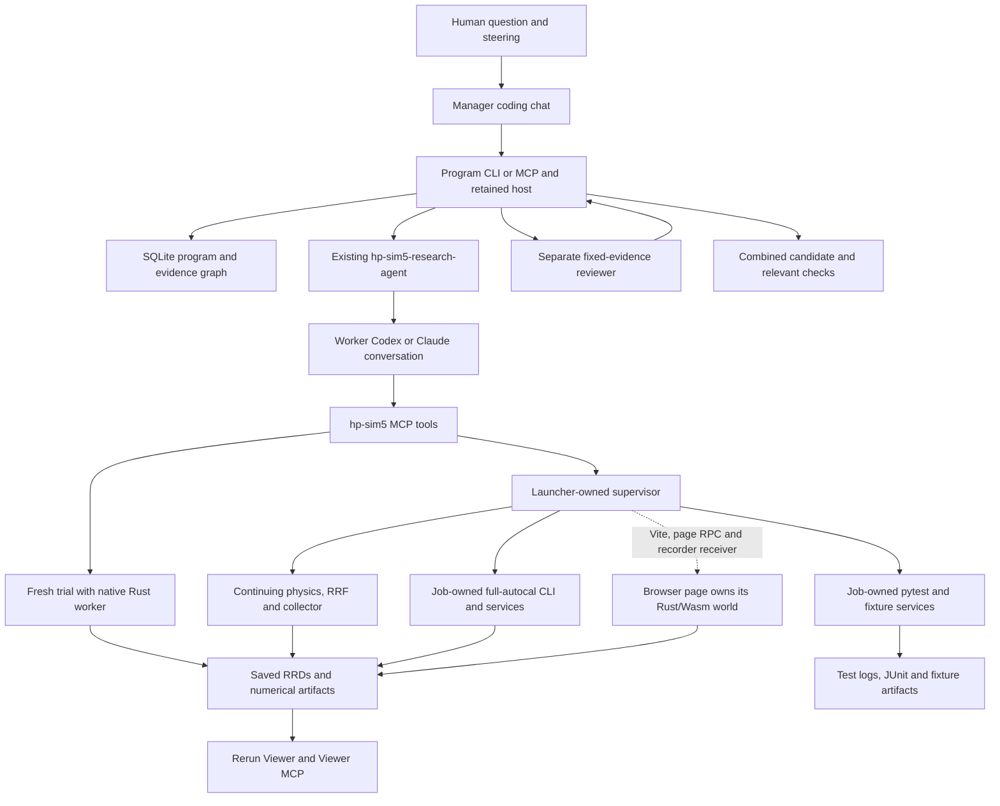

# Research execution architecture

Checked against `30e91632` on 2026-10-12. This page maps the implemented
ownership, configuration and recording contracts. Update it when those contracts
change. The [research README](README.md) contains commands and tool arguments;
[research instructions](AGENTS.md) describe how to conduct and report experiments.

The chat-driven manager above this execution layer implements the store, typed
graph, strategy, reviewed admission, chat tools, bounded pool and combined patch
checks from tasks 007 through 015. Its [entry guide](program.md) and
[manager contract](program-tasks/MANAGER.md) describe the interface. The
[task 016 pilot](../output/research/sessions/2026-10-24-live-manager-release/report.md)
exercised actual CLI dispatch and exposed runtime/client blockers. Full live
release proof remains incomplete. The worker execution map below retains its
2026-10-12 verification scope; manager additions were checked on 2026-10-24.

The manager conversation chooses approaches and assignments. The per-store file
host owns transactional reservations, deadlines and owned-process lifecycle;
SQLite stores questions, graph relations, reviews, steering and decisions.
The existing worker launcher still owns each supervisor/world. Separate review
does not start physics merely to inspect evidence. Integration uses a separate
candidate worktree and an exclusive lease. See [controller limits](program-controller.md)
and [integration cleanup boundaries](program-integration.md).

## Who owns execution

Codex owns the conversation, hypotheses, source edits and experiment choices.
The [launcher](../scripts/research_agent.py) starts a persistent supervisor and
supplies its private [MCP attachment](../scripts/research_attach.py). The supervisor owns continuing services and asynchronous jobs outside
the agent command sandbox. Rerun inspects live or saved evidence; numerical reads
come from experiment telemetry and backend observations.

Recording is optional for fresh trials, continuing collection and browser work.
Matching scenes in these branches produce separate running worlds.

| Workflow and entry point | Execution owner and lifetime | Configuration source |
| --- | --- | --- |
| [Fresh trial](../src/python/hp_sim5_research/experiments.py): `run_experiment` | MCP process owns a native Rust worker for one bounded, synchronous call; Python mirrors observations. No RRF or continuing supervisor world is involved. | Per-call repository USD scene, timestep and motor commands; explicit Python/Warp reference backends. |
| [Continuing collection](../scripts/research_runtime.py): `start_collection`, `send_gcode`, `step_physics` | Supervisor owns one continuing HP3/HP4 world, RRF and collector bridge. Default native Rust physics runs in Node; Python mirrors observations. Optional Python/Warp backends execute their own physics. | Launcher machine/backend, then accepted `configure_session` settings. Collection options choose movement and measurement conditions. |
| [Full-autocal](../src/python/hp_sim5_research/autocal_jobs.py): `start_autocal` | Supervisor owns the job; the production CLI owns a separate headless JS world, RRF, collector and optional recorder. One full-autocal job per supervisor. | Job machine/layering selects stock scene and firmware. Radius/buildup arguments describe the calibration model; optimizer, force, budget and recording mode settings are job inputs. Recording defaults to events without physics snapshots. |
| [Browser](../hp-sim-3d/app/researchControls.js): `start_browser_service`, `browser_action` | The open page owns Rust/Wasm physics and JS application workers. Supervisor owns Vite, page RPC and the requested recorder receiver. Actions select the exact `page_id`. | Page scene controls, `load_scene`, application feature flags and command API. The continuing world's configuration does not configure the page. |
| [Integration tests](../src/python/hp_sim5_research/test_jobs.py): `start_test` | Supervisor owns one test job with a separate pytest process and fixture services. Tests use their own worlds and artifacts. | Named suite allowlist, fixed argv, repository cwd and `.venv/bin/python`; caller supplies a bounded timeout. Slow tests are excluded. |

Fresh trials also work through standalone MCP. Continuing collection, full-autocal
and test jobs require a live supervisor attachment. Command networking and
supervisor networking are separate capabilities. Use the
[command-context socket probe and supervised preflight](README.md#local-networking-for-full-auto-runs)
to measure each in its own context.

## How configuration reaches physics

For the continuing world, the configuration path is:

`launcher/configure_session` → `world_configuration` validation → `prepare_world`
scene editing and baking → candidate `NativeSession` → archive old world → start
matching RRF and collector → accept the new world generation.

The [configuration preparer](../src/python/hp_sim5_research/configuration.py)
freezes authored, designed and baked scenes plus firmware settings. Layering is
applied before cable geometry is baked. The
[runtime](../scripts/research_runtime.py) restarts physics, firmware, collector
connections and encoder references together. Accepted settings are immutable for
a world generation. `reset_session` retains them and reloads scene, JS and firmware
sources; Python edits require a launcher restart. See
[supported settings and recovery](README.md#experiment-tools).

Full-autocal takes another construction path:

`start_autocal` → [AutocalJobs](../src/python/hp_sim5_research/autocal_jobs.py)
validated CLI arguments → [HeadlessSimulation](../autocal/headless_sim.py) →
[headless JS service](../scripts/autocal_headless.mjs) → production
[`createHeadlessWorld`](../hp-sim-3d/app/headlessWorld.js).

It runs the existing collection, fitting, planning, selection and automatic
stopping workflow once per job. It does not inherit the attached world's
configuration. Both JS paths reuse the production world builder, but Python scene
and firmware preparation remains separate between the continuing runtime and CLI.

`base_radii_mm` has different meanings at the two entry points. In
`configure_session`, `[31]` creates four physical 31 mm spools with matching
firmware. In `start_autocal`, `[31]` supplies known or initial fitting radii for
its separate stock world. With `find_radii="off"`, those fitting radii remain
fixed. Likewise, full-autocal's `buildup_factor` is a model parameter, while
`layering` selects its physical winding setup. Record physical settings and
fitting assumptions separately. The shared validation helpers do not make the
configuration contracts interchangeable.

## Recording scope and identity

Let `S` be the launcher-assigned session directory. Its default location is
`output/research/sessions/<session-name>/`. Fresh trial artifacts have their own
repository-level directory. Always use paths returned by tools and manifests.

| Workflow | Evidence location | Recording scope and sampling |
| --- | --- | --- |
| Fresh trial | `output/research/experiments/<run_id>/` | Frozen scene/commands, manifest, final snapshot and JSON telemetry at step zero and every update. Optional RRD records physics updates with the native blueprint. |
| Continuing collection | `S/native/<world_id>/<collection_job_id>/` | Each recorded collection finalizes its own RRD while the world continues. Observations are sampled at 10 simulated Hz and at encoder reads. Dataset, point journal, events and manifests retain roles, settings and step bounds. World inputs live in the parent generation directory. |
| Full-autocal | `S/native/autocal/<job_id>/` by default | CLI logs, datasets, stage artifacts and `sweeps.headless/` command/encoder traces and manifests. `recording_mode` defaults to `events` (one RRD without physics); `none` skips RRD, `sampled` adds physics at stride 100, and `full` retains stride 10. Physics uses compact geometry; events span scene resets. |
| Browser | `S/native/browser-recordings/` | Receiver writes separate recordings for page session/scene generations. Ordinary recording defaults to every physics step; extended recording defaults to stride 10. `browser_status` lists exact files, recording IDs and finalized bounds. |
| Test job | `S/native/tests/<job_id>/` | Job manifest, stdout/stderr, JUnit and pytest temporary artifacts. Fixtures may create RRDs; the test job has no single experiment recording or calibration result. |

Sampling stride applies to physics snapshots; extended control events are retained
at their event boundaries. Continuing collection and full-autocal use different
recorders and sampling contracts. Details are in the
[continuing collection guide](native-collection.md#evidence-and-lifecycle),
[extended reference guide](../autocal/data/references/extended-reference.md) and
[flight-recorder guide](../hp-sim-3d/FLIGHT_RECORDER.md).

Identify evidence by backend, world/run/job ID, recording ID, scene generation and
selected simulation step/time. Simulation clocks, collector clocks and wall time
can differ. Capture browser or native context when steering refers to a particular
observation. Final snapshots and RRDs are recorded observations, not resumable
physics checkpoints. A CLI resume preserves conversation history while starting a
fresh world; a still-running service-only supervisor can be reattached.

## Stops, recovery and current limits

Each supervisor allows one collection, one full-autocal job and one test job
to run concurrently. Native reset/configuration rejects active collection or
full-autocal jobs and an in-progress preflight. Cancel those jobs explicitly
before changing the world. Isolated test jobs can continue through a native reset.

Poll asynchronous jobs between conversational turns. Use `cancel_collection`,
`cancel_autocal` or `cancel_test` to stop the corresponding execution. Codex turn
interruption and Rerun playback pause do not stop simulation. Browser pause acts
on the selected page; finish its active workers before direct commands or bounded
stepping. See [job and browser controls](README.md#jobs-shared-browser-state-and-steering).

Collection cancellation preserves partial measurements and records its stopped
boundary, then requires coordinated reset. Full-autocal cancellation stops its
own services and preserves partial evidence without accepting best-so-far.
`accepted` means the production CLI reached its automatic stop and applied a
candidate with a finalized recording when enabled; accuracy needs separate measurements.
Test cancellation preserves an unfinished check with a blocked outcome.
Supervisor shutdown retires owned services and jobs.

At the checked revision, these boundaries still need attention:

- Native reset/configuration also closes browser RPC, Vite and its recorder
  receiver. Reopen the URL from `start_browser_service` to reconnect browser work.
- Preflight treats an exited optional browser service as a world-health failure.
  Inspect individual checks and restart that service before repeating preflight.
- Preflight checks live firmware kinematics and anchors, but does not detect live
  `M666` radius/buildup drift from the frozen configuration. Verify these settings
  before interpreting collection evidence when firmware has been edited.
- World baking/construction and JS worker reads can block the supervisor event
  loop. Preparation responsiveness and worker reply deadlines are not guaranteed.
- Continuing configuration supports stock HP3/HP4 scenes, custom radii with
  layering disabled, and stock layered designs. Custom anchor layouts are rejected.

## Where to read next

| Need | Document |
| --- | --- |
| Launch, attach, configure worlds, select tools or recover a session | [Research README](README.md) |
| Choose hypotheses, budgets, measurements and reporting rules | [Research instructions](AGENTS.md) and [autocal research workflow](Advanced_research_example_autocal.md) |
| Understand collector units, firmware barriers, clocks and cancellation | [Continuing collection](native-collection.md) |
| Work in the exact shared browser page | [Browser workflow](More_on_browser_based_work.md) |
| Understand the production calibration stages | [Autocal README](../autocal/README.md#independent-stage-experiments) |
| Inspect the original architectural reasoning | [October 5 integration investigation](investigation.md) and [October 6 interactive-agent proposal](../research-agent-architecture.md) |
| Check what was actually exercised | [Interactive architecture verification](architecture-verification.md), [full-autocal verification](autocal-jobs-verification.md), [settling/bake follow-up](autocal-settling-review.md), [configurable-world verification](configurable-worlds.md) and [preflight/test verification](preflight-tests-verification.md) |

The investigations describe decisions and earlier implementation gaps. Verification
reports describe particular runs and their limits. Use this map and the research
README for current contracts, then follow the reports for supporting evidence.
