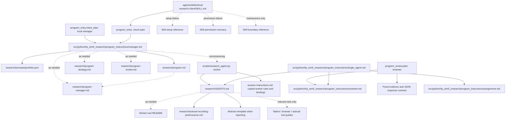

# Research instruction audit

Audited 2026-11-04; prompt portfolio boundary reviewed 2026-11-05. This is a
maintenance reference, not an agent startup read.
The scope is the active local/cloud manager, launched worker, reviewer and
single-agent entry paths, including their optional documentation. Historical
reports, frozen submissions and old task cards are evidence, not instructions.

## Current instruction graph

Solid arrows mean a required read or injected text. Dotted arrows mean optional
navigation. The launcher/code nodes matter: Markdown links alone miss text that
is copied into a session. The root AGENTS instructions may also be loaded by the
coding client independently of these routes.

Solid arrows mean a required read or injected text. Dotted arrows mean optional
navigation. The launcher/code nodes matter: Markdown links alone miss text that
is copied into a session. The root AGENTS instructions may also be loaded by the
coding client independently of these routes. Role contracts are packaged with
the controller; `research/prompts/` contains research missions only.

## Findings and changes

| Finding | Consequence | Resolution |
| --- | --- | --- |
| Machine selection repeated in shared workflow, strategy guide and cloud guide; only cloud rejected omissions | Same assignment had different defaults by transport | Shared worker validation rejects missing choices; capabilities explains both supported fields. Direct launcher requires `--machine`. Removed prose copies; retained executable JSON examples. |
| Cloud entry repeated runtime-check, installation and permission-recovery procedures from guide/supplement | Three copies could diverge | Entry only opens/binds and routes; supplement routes to the operating guide. |
| Cloud skill repeated dispatch, cancellation, review and save procedures | Another full instruction copy; worker attachment advice lagged behind the guide's file-relay route | Skill is a short entry router. Cloud guide owns adapter procedures. |
| Shared workflow required worker AGENTS, broad README, integration essay and program guide | Managers paid for worker experiment instructions and navigational cycles | Shared manager prompt no longer requires those reads. Worker rules still arrive through the launcher. Integration essay is optional background. |
| Shared program-manager guide described cloud env loading, relay mechanics and extra cancellation acknowledgements | Local managers learned adapter procedures they cannot use | Removed those details; retained a conditional link to the cloud operating guide. |
| Worker README repeated cloud startup, saving and pilot history | Workers were routed back into manager/cloud operations | Replaced with optional program-guide navigation. |
| Single-agent entry pointed to a shared-looking symlink whose target was the cloud entry | Local research could accidentally select cloud mode | Points to neutral program guide. Compatibility symlink remains for existing callers. |
| Physics delivery rule repeated in worker AGENTS, README, manager workflow/tools and reviewer prompt | Multiple copies of a rule already enforced by tests/admission | Removed these copies. `npm test`/CI own stability execution; review admission still enforces candidate-specific evidence in code and its detailed reference. |
| Single-agent entry repeated worker recording, reporting, citation and catalog instructions | Same session read the rules twice | Entry now owns only iteration orchestration, briefing authorization and self-review. Worker AGENTS owns experiment/reporting practice. |
| Cloud child could inherit the whole manager conversation in addition to queued instructions | Worker/reviewer received unrelated manager instructions and duplicated context | Cloud dispatch specifies fresh actor contexts (`fork_turns="none"`) with queued prompt/instructions supplied once. |
| Research missions and role plumbing shared `research/prompts/`, and the manager had no enumerated prompt portfolio | Prompt choice depended on manual recall; role contracts could be mistaken for missions and broad assignments could repeat reviewed work | Added validated `research/prompts/portfolio.json` and the `prompt_portfolio` operation. Moved manager, reviewer, assignment and single-agent contracts into packaged `program_instructions/`; route plans retain the selected prompt ID, path and hash, and unregistered mission files fail validation. |

## Runtime boundaries

Cloud open returns the shared manager workflow text as `manager_instructions`;
the skill does not duplicate it or require a separate reading hop. The cloud
adapter, bridges, setup scripts, report assets and tests now live under
`.agents/skills/cloud-research-client/`. `scripts/cloud/` and the old entry prompt
and symlink have been removed. Cloud tests remain in default pytest/CI discovery.

Workers receive their assignment/strategy contract separately from standing
research rules; those bindings are data, not another instruction manual.
Reviewers receive the review prompt plus exact submission/schema/deadline data,
not manager or worker operating guides. Local Codex gets worker rules through
`developer_instructions`; Claude receives them through `instructions.md`.
The cloud broker supplies the same queued files to a fresh actor context.

## Ownership and remaining boundaries

| Information | Owner / discovery point |
| --- | --- |
| Machine choice, accepted settings, conflict diagnostics | `program_workers.py`, controller `capabilities`, launcher `--help` |
| Manager decisions, bounded delegation, review sequence, saving | Shared manager workflow |
| Experiment setup, recording decisions, evidence/report practice | `research/AGENTS.md`; topic guides only when relevant |
| Cloud actor dispatch, credentials, file relay, permission recovery | `.agents/skills/cloud-research-client/SKILL.md` and optional recovery reference |
| Mission-prompt ranking and expected delivery | `program_prompts.py`; `research/prompts/portfolio.json` |
| Scientific review criteria | `src/python/hp_sim5_research/program_instructions/reviewer.md` |
| Fixed review schema, identity and engineering admission | `program_review.py`; detailed `program-review.md` reference |
| Physics stability | Default test pipeline; failure notes in `tests/benchmark/README.md` |

Cloud-specific procedures in shared mandatory instructions are a layering error.
Conditional links to the optional adapter are navigation, not a reason to load
its instructions locally. Shared code reporting `client_transport` or preserving
a bound mode is a common interface contract and belongs in the shared layer.
Socket restrictions are possible locally too; common preflight/socket diagnostics
are not inherently cloud-specific.

Architecture reports and historical task cards remain optional references,
not startup instructions. Archived evidence is unchanged. The optional visual
report lives inside the cloud skill and is refreshed from the active source
prompts.

An exact once-only context guarantee also depends on the coding client: automatic
AGENTS discovery, previously read files and an existing parent chat are outside
this repository's prompt loader. This cleanup removes explicit redundant read
edges and copied procedures; it does not claim to erase client-provided context.

## Verification

The program/controller/worker/review tests, cloud adapter tests and launcher tests
passed across split runs. The cloud relay and launcher portion was rerun with
local sockets permitted after the sandbox rejected the relay fixture's bind.
New checks cover omitted choices without session creation or budget charges,
commissioned choices and conflicts in both transports, discoverable help, prompt
registration, exact selected-prompt delivery and route provenance. The cloud
skill passed its frontmatter validator. The offline visual report was regenerated
from source prompts, and `git diff --check` passed. These are code, CLI and
process/relay tests; no new live model research trial was commissioned.
