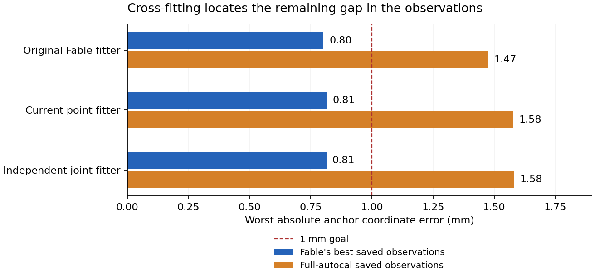

# Recovering the Fable proof of principle in full autocal

## What the early success established

The saved Fable measurements still support their reported result. Re-running its archived fit on `v_equal10.out.json` gives **0.8012 mm absolute** worst anchor-coordinate error and **0.1201 mm translation-aligned** error. The 1.5 and 2.5 N-per-strand recordings give 0.6217 and 0.5160 mm aligned error, but 1.2678 and 2.3403 mm absolute error. Thus the best case really crossed the absolute 1 mm target; the full quoted 0.1–0.6 mm range describes shape after removing a common translation.

Those recordings used the production physics world with direct motor control, 48–55 designed static poses spanning approximately 0–1200 mm, explicit torque-axis/force selection and 20 solver iterations. They bypassed firmware, the adaptive sweep selector, autocal filtering and final history selection. Planning used true anchors by default; the archived fit initialized anchors at truth and used recorded positions as inner-solver seeds. That is a useful physics diagnostic, rather than a demonstration of blind closed-loop calibration. The earlier robustness sweeps with erroneous planning anchors, unequal stiffness and mass were principally static-model experiments; they did not establish the same bounds in full production collection.

## Fresh offline crossover evidence

This follow-up replays saved data without starting a simulator. The current point fitter and independent joint fitter use a fixed anchor seed perturbed by up to 30 mm, derive point positions from lengths, and fit their own D offset. They receive no recorded physical point positions. Four encoder lengths per direct pose are preserved exactly in a range-fit dataset; its one-point groups are not ellipse sweeps.

| Saved observations | Original Fable fit: absolute / aligned, mm | Current point fit: absolute / aligned, mm | Independent joint fit: absolute / aligned, mm |
| --- | ---: | ---: | ---: |
| Fable, 1.0 N/strand, 48 poses | 0.801 / 0.120 | 0.814 / 0.179 | 0.814 / 0.193 |
| Fable, 1.5 N/strand, 55 poses | 1.268 / 0.622 | 1.331 / 0.725 | 1.400 / 0.866 |
| Fable, 2.5 N/strand, 55 poses | 2.340 / 0.516 | 2.307 / 0.600 | 2.285 / 0.609 |
| Nominal full autocal, 160 points | 1.475 / 1.312 | 1.577 / 1.417 | 1.580 / 1.422 |



The current point fitter can reach the target on Fable's good observations; the original Fable fitter does not recover that accuracy from the full-autocal observations. This makes collection design, physical protocol and length interpretation the first diagnostic priority. It does not prove a global optimum, rule out fitter defects or identify one physical cause. The full run's applied history result is 1.68 mm, distinct from these offline full-data fits.

A concrete collection difference is workspace coverage. The full recording's `max_travel_mm` is **389.72 mm**, and `planning_pass.py` uses that value both for the candidate-delta range and a total fixed-delta budget. Its point heights reconstruct to approximately **40–423 mm**, using known scene anchors and the biased observed lengths. These are reconstructed, not independently recorded physical positions. They show a much narrower nominal region than the successful direct plan's recorded 0–1200 mm. Shortening D is enabled, but the active learner cannot choose arbitrarily large upper excursions outside that candidate budget. Both setups use 20 solver iterations. The nominal profiled force target is about 1.01 N per strand, close to the best direct plan's 1.0 N; a mere force-level difference is not an established explanation.

As a cheap counterfactual, retain only Fable observations below 450 mm. Original-fitter aligned error changes from 0.120 to 0.578 mm (1.0 N), 0.622 to 1.136 mm (1.5 N), and 0.516 to 1.711 mm (2.5 N). Seeded subsets with the **same point counts** but drawn across the full height range give 0.207, 0.687 and 0.736 mm. This supports testing coverage early. It does not isolate height alone: XY distribution and torque/force composition also change, and the count-matched check uses one seed. Greater point count alone did not make the full-autocal recording better.

The original stretch diagnosis remains useful. A small, smooth length bias can be absorbed into anchors with tiny residuals. However, the original geometric-length substitution established that cause on the original recorded runs. The newer full-run residuals have not yet received an equivalent point-by-point geometric-length/actual-tension analysis. Broad robustness tests exposed failures; the missing next experiment is a controlled connection to the passing reference.

## Ordered implementation and experiment plan

1. **Freeze a passing reference and reproduce its physics.** Keep the best saved plan and raw observations as an offline acceptance fixture; the crossover above establishes the fitting reference. Re-run that exact static plan in the current world at 20 iterations and target 1.0 N/strand, recording sampled positions, all line tensions, raw/mean encoders, motor modes and timestamps. Match initial reference, scene, settling and point order. Success is recovering the recorded sub-millimetre behavior with current physics, not just matching a fit on old data. Then perturb the planning seed so truth-based planning is removed. Simulator truth is diagnostic evidence, not a production calibration input.

2. **Put the same fixed plan through firmware before reintroducing adaptive selection.** Preserve the per-axis length targets and torque requests, reference state, ordering and settling; compare the achieved poses with the direct collector in the same scene. Diagnose any additional Cartesian/flex transform as a separate step, rather than silently changing those motor targets. Cross-fit both datasets with original, current point and ellipse fitters where the observations form valid ellipse sweeps. If the firmware pair regresses, substitute recorded geometric lengths on the same poses: recovery identifies a measurement/reference error; lack of recovery redirects attention to geometry/extraction/fitting. Inspect fixed-line target versus measured length, force tracking, direction changes and firmware flex references. Independently optimizing new plans on each path would confound this comparison.

3. **Recover the useful coverage in production collection.** Treat the approximately 390 mm bootstrap-derived budget as a hypothesis to test, not a validated description of all feasible upper workspace. Establish feasible upper poses, then supply a fixed multi-height collection schedule or a static-pose mode that can reproduce the reference. Avoid simply raising a global travel bound and sending unverified sweeps. Compare upper-pose schedules with the existing sweeps at matched observation counts. Measure the weakest anchor/offset directions and the amplification of coherent force/length errors, as well as ordinary information gain. Restore adaptive planning and stopping only after it reproduces the fixed design's accuracy; require achieved coverage/information rather than consensus alone.

4. **Close shape and physical-home error separately, then test robustness.** Aim for consistent shape error comfortably below 1 mm so there is margin for home/reference error. The full recording still has about 1.3–1.4 mm aligned error under all three offline fits, so translating anchors alone cannot meet the target. A final physical-home correction needs a measurable, identifiable reference protocol independent of nominal stiffness; simulator truth can quantify the missing shift during diagnosis. Once both metrics pass on nominal HP3, run paired full-path trials for HP3 stiffness 10000/12000, nominal HP4 and worn HP4 with actual simulated encoder-noise seeds. Keep the stopping/selection logic in that validation. Require worst **absolute** coordinate error <=1 mm and report aligned error alongside it; low residuals or agreement between fitters are not substitutes. Further layout expansion comes after this matched bridge, rather than serving as another variable in it.

The next production change should therefore enable a faithful, fixed reference collection with sufficient height coverage and sampled diagnostics. More generic optimizer tuning, a home translation alone, or another broad battery on the unchanged protocol would not answer the current discrepancy.

## Reproduction and limits

Run from the repository root:

```bash
.venv/bin/python research/output/program-2026-11-15-review-and-harden-stretch-insensitive-autocal-robust-bootstrap-h-3fa9855a/validation/fable-gap/diagnose.py
```

[Helper](validation/fable-gap/diagnose.py) and [results with hashes](validation/fable-gap/results.json) identify source revision, input files, fitter sources and subset indices. These are local solver results with diagnostic near-truth initialization, not a fresh production-path or hardware validation. Original and current fitters use different losses and priors; this comparison does not claim their objectives are identical. RMS definitions also differ. No production code changed in this follow-up. No simulator or delegate remains running.
