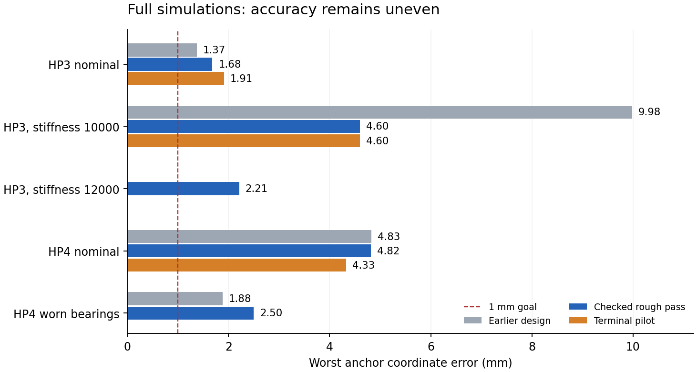
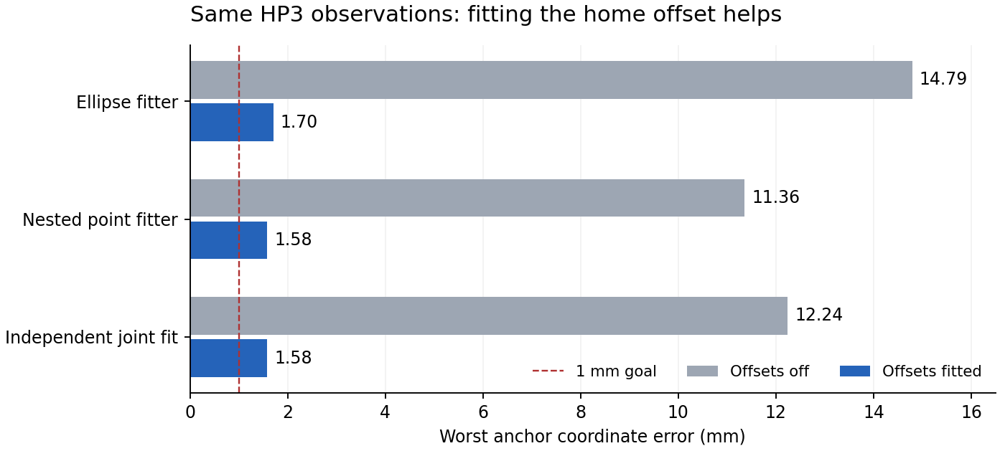

# Autocal hardening, fitter comparisons and robustness

## Result and scope

Reviewed `1254e..5f718` and the saved Fable conversation, implemented reliability fixes and reproducible comparison tools, and exercised the production simulator path. Home offsets now default on. A checked rough pass replaces the unconditional three-sweep handoff to force profiles. The current nominal HP3 result is **1.68 mm** worst coordinate error and **1.58 mm** after subtracting a common translation. It is not a sub-millimetre result or an improvement over the previous nominal 1.37 mm sample. These runs use simulated firmware, collector and physics, not hardware.

The historical single-height offset failure and the soft-line battery failure show that fit score and repeatability do not certify anchor accuracy. The strongest alternative explanation is a solver problem: independent joint range least squares also has several-millimetre errors on the problematic recorded data, so switching optimizer alone has not removed the model/data bias. No global-optimum proof is claimed.

## Implemented behavior

- `--fit-home-offsets` defaults on in the CLI and library composition. `--no-fit-home-offsets` genuinely disables it, including on profiled data, and can be set per full-auto variant. Joint spool/offset fitting is unsupported and rejected explicitly; historical spool regressions use their original no-offset model.
- The rough pass checks convergence, two scaled starts, full local rank, at least 80% inliers, and <=25 mm estimated parameter standard deviation with a minimum 0.5 mm line-error assumption. It collects another informative constant-force sweep when needed, up to nine extras, then stops if unreliable. On the saved nominal run the three-sweep estimate fails at 76.15 mm; one added sweep with D shortened passes at 18.19 mm. All rough sweeps are remeasured with matching profiles, and only that second set enters refinement. This costs two more collected sweeps than the previous nominal design, rather than a complete first autocal run.
- Atomic progress markers prevent interrupted/rejected rough data from being consumed on restart. Incomplete passes require a fresh dataset path after reestablishing encoder origin, with partial evidence retained. A complete marker validates the dataset and authenticates its bootstrap prefix; later adaptive sweeps may extend it. Corrupt, replaced or mixed-model data are rejected before simulator startup. This is application-level consistency, not a power-loss durability guarantee.
- Force profiles are selected by direction **and fixed anchors/targets**, with missing or ambiguous matches rejected. Nonpositive predicted-tension tails are omitted. A profile marker means forces were commanded, not that actual strain was equal. Profiled runs refuse constant-force continuation or missing W/N/Y/tuning inputs before collection. Existing constant-force datasets stay constant-force.
- Candidate-specific home offsets are applied once to frozen held-out predictions. The common-length anchor comparison remains a separate history-ranking heuristic and can favor the latest length model; it is not an unbiased estimator comparison.
- New zero-tension collection and its extrapolation implementation were removed. Historical projected data still replay with projected lengths; projection is resolved before profile-marker guards, noise means and offsets are disabled, and mixed projected records remain invalid.
- Final fit quality is explicitly described as agreement with the length model. The final JSONL summary records selected anchors, fitted anchors and compensation decisions.

Shared final fixes also prevent forwarded collector aliases from overriding planned acquisition fields, make Python dataset replacement atomic, preserve a stop arriving during the final fit, and stop without retry if application is interrupted.

The [first integration review](session-2026-11-15-review-production-integration-of-pose-fit-information-planning-a-84abd4be/report.md), [combined review](session-2026-11-15-independently-review-the-combined-autocal-hardening-candidate-fo-ec4f1013/report.md), and [targeted follow-up](session-2026-11-15-review-fixes-to-bootstrap-restart-refusal-measurement-model-puri-8dda2804/report.md) preserve findings and checks. The last review's complete-marker finding was fixed afterward with schema validation and a bootstrap-prefix hash. [State-integrity evidence](validation/state-integrity.json) exercises the real recorded bootstrap, full adaptive dataset, modified point and malformed JSON.

## Production simulator evidence

The [baseline battery](session-2026-11-15-build-and-exercise-reproducible-full-hp3-hp4-autocal-sanity-batt-fc7253a7/report.md) ran four fresh scenes with the earlier production implementation. Each case is one deterministic trial.

| Baseline scene | Worst coordinate error, mm | Translation-aligned error, mm |
| --- | ---: | ---: |
| HP3 nominal | 1.37 | 1.23 |
| HP3, stiffness 10000 instead of 20000 | 9.98 | 9.59 |
| HP4 nominal | 4.83 | 2.84 |
| HP4 worn bearings | 1.88 | 0.64 |

All stopped normally with favorable fit scores. Wear did not establish an accuracy benefit: mechanics, force tuning and selected observations changed, and there is only one trial per condition. The reference is the initial nominal firmware geometry, checked for these catalogued scenes; modifying geometry would require an independently verified reference.

Two frozen nominal HP3 hardening runs returned the same rounded 1.68/1.58 mm errors. [First frozen run](validation/hp3-final/summary.json) used revision `95d4ca4d`; [stateful run](validation/hp3-stateful/summary.json) used `cbc80581` and completed its explicit state transition. Their manifests retain source hashes. These deterministic repeats establish reproducibility under this configuration, not a scatter distribution. The earlier integration run changed source during collection and is retained as such, not counted as final validation. The first attempt stopped on a diagnostics-schema error, which was fixed; its partial evidence is retained.

The [hardened variant evaluation](session-2026-11-15-evaluate-the-hardened-candidate-on-full-hp3-hp4-compliance-and-b-3c7b0091/report.md) adds four full runs on frozen `921ced3c`. Every run stopped normally, collected eight sweeps / 160 fitted points and failed the 1 mm accuracy gate.

| Hardened scene | Worst coordinate error, mm | Translation-aligned error, mm |
| --- | ---: | ---: |
| HP3 nominal (parent run) | 1.68 | 1.58 |
| HP3, stiffness 10000 | 4.60 | 2.16 |
| HP3, stiffness 12000 | 2.21 | 1.22 |
| HP4 nominal | 4.82 | 2.83 |
| HP4 worn bearings | 2.50 | 1.055 |

The half-stiffness case improves substantially relative to the earlier run, nominal HP4 barely changes, and nominal HP3 and worn HP4 worsen. These runs change the collection design and count, so this is not a matched-budget ablation of any single change. The rough gate accepted fits with actual errors up to 24.77 mm; it is a coarse planning check, not final accuracy certification.

Final selection also has a concrete limitation: on soft HP3 it applied an older 4.60 mm candidate while the subsequently printed fit was 2.44 mm off. That last fit had no future sweep for held-out comparison and failed to join a tight consensus. This is selection regret on one recording, not a rule that latest is best. A [bounded terminal-validation pilot](session-2026-11-15-test-one-bounded-terminal-validation-sweep-that-compares-frozen-43d8bbc3/report.md) tested one fresh sweep against every frozen candidate without refitting. Nominal HP3 worsened from 1.68 to 1.91 mm, soft HP3 stayed at 4.60 mm, and nominal HP4 improved from 4.82 to 4.33 mm. The live option was withdrawn after mixed results and independent review findings; recordings and offline replay remain. Lower common prediction cost still did not guarantee better geometry.

These bars are individual simulated trials with differing collection costs. Missing cells mean untested cases; the terminal pilot was withdrawn.

## Same-data fit comparisons

The [CLI comparison](validation/joint-cli-comparison/results/summary.json) fits the exact final eight-sweep HP3 recording using a common archived stage's solver settings and explicit offset overrides. Both arms see the same observations. Errors below are worst absolute anchor coordinate errors in mm.

| Fitter | Offset disabled | Offset enabled |
| --- | ---: | ---: |
| Production ellipse | 14.79 | 1.70 |
| Production nested point fit | 11.36 | 1.58 |
| Independent joint range baseline | 12.24 | 1.58 |

This supports the extra offset parameter on multi-height data. The baseline battery's earlier constant-force single-height example instead worsened from 8.47 to 60.38 mm when enabled, with almost unchanged cost. Identifiability and collection design matter; a small residual does not resolve the ambiguity.

The production point fit remains alongside the ellipse fit in every stage, with RMS, anchors and differences logged. It supplies the ellipse's offsets, so that comparison has shared nuisance estimates. The optional offline `--joint` baseline separately optimizes gauge-constrained anchors, its own offsets and every point position on the unshifted observations; it does not use ellipse masks or offsets. Analytic derivatives matched finite differences in the targeted review. It shares extraction and gauge conventions, has a local robust two-pass objective with Gaussian offset priors, and makes no global-optimality claim. Projected and fitted-spool comparisons are explicitly refused until their length models are validated.

[Joint fits on four earlier full recordings](validation/joint-baseline-on-recordings.json) also retain the problematic soft-line and HP4 errors. [Stricter-budget attempts](validation/joint-baseline-strict-tolerance.json) failed to converge in two cases; the later 1000-evaluation/1e-8 settings terminated locally. Solver termination is not an accuracy pass.

The hardened evaluator also tested explicit offset/filtering combinations on earlier and current full recordings. Offsets helped all four multi-height examples, but filtering effects were mixed: on earlier soft HP3 without offsets it increased ellipse error from 23.01 to 48.45 mm while lowering normalized cost. On candidate soft data, filtering with offsets reduced absolute error but worsened translation-aligned error. The production point fit has no sweep-filtering switch.

A seeded stress test adds 0.03 mm Gaussian noise to raw **and mean** drive/sensor lengths and +1 mm at three sensor observations (seed 9212026). On the earlier soft dataset with offsets, filtering lowered ellipse error from 8.45 to 7.74 mm; point error remained 8.17 mm. This is synthetic corruption of recorded lengths, not full simulated encoder noise. The initial invalid raw-only perturbation, which left the used means unchanged, is retained and excluded from evidence of robustness. See the evaluator's report and reusable preparation recipe for exact controls.

## Physical home and broader layouts

A common home translation remains relevant to absolute coordinates, but the 1.58 mm translation-aligned error shows it is not the whole remaining problem. The [home investigation](session-2026-11-15-determine-and-implement-physically-justified-final-home-shift-co-fc8f5233/report.md) found that offsets and configured stiffness alone do not identify physical home; RRF and Klipper already contain an absolute flex reference term. The implemented helper translates the final anchors only with independently sourced, compatible extension evidence, a practically slack home, identifiable geometry and bounded uncertainty. It rejects consensus-averaged fits whose evidence is not tied to that fit. Ordinary collection supplies no such evidence, so automatic physical-home correction is **not operational**. The algebra and sign were tested synthetically; coherent wrong extension evidence can pass the consistency gate. Measuring a usable home reference without double compensation remains an open physical protocol.

The [four-high and cube pilot](session-2026-11-15-review-production-integration-of-pose-fit-information-planning-a-84abd4be/report.md) rejects a direct generalization. Four-high can have gravity-supported feasible poses without positive zero-load self-stress; it needs affine load equilibrium, nonnegative tensions and branch/gauge handling. Cube corners has five tension-null directions and six nominally fixed lines; the two-sphere predictor ignores four constraints and the synthetic pilot misses them by up to 1825.6 mm. It needs active/slack sets, all fixed-length constraints, bounded tension allocation and an observability study before production collection. The rollout plan starts with synthetic feasibility/branch tests, then bounded recorded simulator pilots at matched collection cost, compliance and payload variations, and finally firmware/hardware validation. These layouts remain on their legacy production path.

## Reproduction and limits

Use `.venv/bin/python`. `autocal.tools.sanity_battery` supports scene/stiffness variants and a 1 mm default accuracy threshold; a normal stop with inaccurate geometry returns failure. `autocal.tools.compare_fit_replays` takes a frozen fit stage, explicit JSON option arms and optional `--reference-m669`/`--joint`. The README includes commands. `autocal/tools/regress_calibration_logs.py` remains a historical stability check: two selected HP3/HP4 logs reproduced exactly after preserving no-offset settings. Their agreement does not establish accuracy.

The final combined quick suite passed **645 Python tests** (73 slow/heavy deselected); the collector suite separately passed **126 JavaScript tests**. [Verification record](validation/final-checks.json) identifies the commands and code revision. The real interrupted-collection test separately passed, retaining partial points, finalizing its recording and stopping all owned services ([output](validation/interrupted-bootstrap-pytest.log)). Production simulator runs provide separate end-to-end evidence. No physics solver was changed. Large event journals are Git-ignored and inventoried with paths, hashes and sizes; no off-host backup is established. No hardware or full simulated encoder-noise validation is claimed here. Open work is to identify and reduce the remaining physical/model bias, establish a usable home-reference protocol, and run full simulated encoder-noise and repeated-trial studies. The new rough checks prevent the demonstrated underconstrained handoff and inconsistent restarts, but do not guarantee final accuracy.
