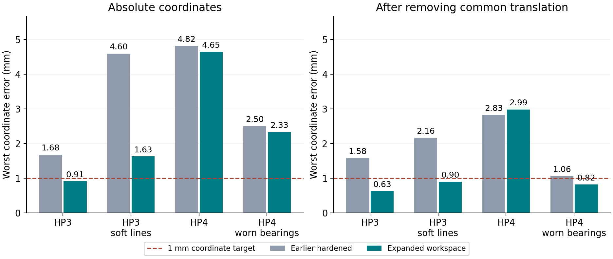
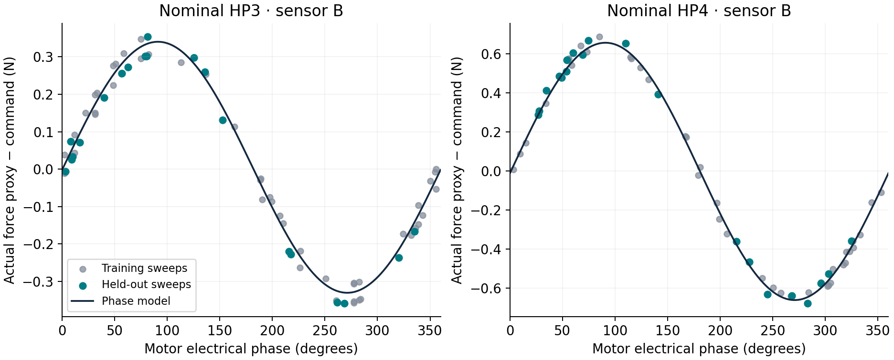

# Production workspace exploration and sensor reserve

## Change and scope

The permanent bootstrap-sized travel ceiling is removed from automatic HP3/HP4 collection. Candidate `dfc0e3e3` contains the production changes from `6ab979c3`, `ecf052eb`, `8338be8f` and `dfc0e3e3`. It learns per-anchor fixed-target bounds from completed nonempty sweeps, expanding each observed interval by one tuned excursion. `max_travel_mm` seeds that excursion; it no longer caps all future fixed targets. The old sum-of-fixed-deltas budget is deleted from both ordinary and rough planning. Lower-anchor targets may be negative. No scene geometry or physical positions enter planning.

Carrying D stays fixed with nonpositive length change. Predicted tension feasibility, actual positioning, fixed-anchor drift, slip, stability and transport guards remain. The pose ranker's conservative pretension-share heuristic remains; this change does not claim to enumerate every reachable pose. User-specified delta bounds still take precedence. The old geometric-spread stopping heuristic is now opt-in: agreement between historic fits does not show that the workspace has been explored. Patience and the overall iteration budget remain.

## Reserve and boundary evidence

The first three nonempty sweeps require actual sensor rewind of half a spindle turn from the maximum observed payout, captured before stronger preload. Encoder gearing converts spindle turns to motor angles. The old radius-based drive step remains only as a seek increment: it never guaranteed a sensor half turn, and on stock HP3 it represented only a quarter spindle turn on the drive. Short intervals cannot invent a move beyond the observed endpoints.

After three completed sweeps, an individual measurement may use less reserve only after a fresh, reversible local probe at that point's intended sensor force. The probe needs significant sensor response in both directions, correct sign, held-drive tracking and encoder recovery. Fixed anchors are checked throughout. Noise means and raw samples must both satisfy the reserve or the tested local interval. The accepted stable/noise sample is reused without a force change, avoiding an unverified recapture. Metadata records probe outcomes, force, observed interval and absolute collection timestamps. This is empirical evidence of a locally tensioned transmission, not an absolute spool-empty sensor or a proof against every mechanical failure.

An unresolved sensor response or sensor hysteresis disqualifies that point. Insufficient valid points makes a later sweep unmeasurable. Only this typed outcome, followed by a successful held-mode return to origin, can become `acquisition_rejections`. The partial sweep is discarded from fitting and preserved in the acquisition journal. The planner excludes that configuration and tries another without refitting unchanged data or advancing convergence patience. Rejected attempts still consume the overall iteration budget. Transport, instability, fixed-line drift and failure to restore the held drive or return to origin abort instead. An ordinary collector subprocess failure exits without applying a calibration.

## Corrected force policy

Firmware's line-flex equation is `F*(U*distance+Y)/(EA*U²*N)`. The invariant therefore uses effective strand count `N*U` and carriage-equivalent extra length `Y/U`. The earlier HP3-only formula was wrong for reeved HP4. Profiles now record the corrected policy and preserve the original dataset's strand target across force retuning.

Force floors no longer clamp the intended profile into a different strain model. The table retains one contiguous arc where all tensions are positive and both possible sensor directions exceed the tuned minimum. Collection intersects the measured drive interval with that table's support; unsupported endpoint holding may be used in transit, never to publish a measurement. Live continuation refuses mixed constant/profile data and incompatible older profile versions before simulator startup. Historical datasets remain available for offline replay.

Encoder parsing also now accepts scientific notation near zero. The previous parser could split one small number into two readings and produce a false stability timeout.

## Validation and evidence

All four completed validation trials stopped normally on patience and applied their selected calibration. The battery evaluates the **worst absolute anchor coordinate**, with translation-aligned coordinates reported separately:

| Simulated case | Revision | Refinement sweeps / points | Actual sampled height, mm | Absolute / aligned error, mm | 1 mm coordinate gate |
| --- | --- | ---: | ---: | ---: | --- |
| HP3 nominal | `dfc0e3e3` | 10 / 197 | 40–1729 | 0.910 / 0.628 | Pass |
| HP3, stiffness 10000 | `5251f749` | 7 / 139 | 26–994 | 1.630 / 0.895 | Fail |
| HP4 nominal | `dfc0e3e3` | 9 / 179 | 49–1728 | 4.650 / 2.985 | Fail |
| HP4 worn bearings | `5251f749` | 10 / 193 | 29–1502 | 2.330 / 0.818 | Fail |



The earlier corresponding hardened trials were 1.68/1.58, 4.60/2.16, 4.82/2.83 and 2.50/1.055 mm. These are individual simulations with different observations, acquisition cost and protocols; they do not isolate the contribution of each change. All cases also collected a separate rough pass. The final-code soft/worn trials took 412 and 1689 seconds, respectively. Worn bearing dynamics and additional high-pose probes materially increase runtime.

The worn-bearing run exercised three real rejection-only collections near D=-1615 mm. Each had insufficient coupled points, returned successfully under the new checks, retained its boundary evidence, and replanned without refitting unchanged observations. Later configurations succeeded and normal patience stopping followed. The final dataset contains 193 valid points; rejected partial sweeps do not enter fitting. The accepted later local-reserve waivers contributed 32 points on nominal HP3, 19 on nominal HP4, five on soft HP3 and two on worn HP4. The remainder retained the half-turn reserve. Metadata preserves each local test rather than treating it as permanent permission.

The frozen nominal HP3 run at `dfc0e3e3` stopped normally on patience, applied its history-selected consensus, and passed the default coordinate gate: **0.910 mm worst absolute coordinate / 0.6275 mm aligned**. Its largest full 3D anchor-distance error is **1.068 mm**, so passing the coordinate gate should not be described as every anchor lying within a 1 mm sphere. It collected 197 refinement points over 10 sweeps, with actual sampled heights **40–1729 mm**, in 543 seconds wall time; the separate rough pass is additional acquisition. No scene geometry entered selection, collection planning or production fitting. This is one trial, not a distribution or a matched-budget attribution to height alone. See [summary](hp3-final/summary.json) and [sampled diagnostic](hp3-final/physics-diagnostics.json).

The frozen nominal HP4 run at the same revision also stopped normally and applied its consensus, but failed the accuracy gate: **4.650 mm absolute / 2.985 mm aligned**, from 179 points across nine sweeps and actual sampled heights **49–1728 mm**, in 688 seconds. Wider coverage and the corrected force law therefore have not solved nominal HP4. Its [same-pose point fit](hp4-final/point-fit-counterfactual.json) gives 5.165 / 3.373 mm from encoders and <1e-10 mm with ideal geometric lengths substituted. Its [same-data fitter comparison](hp4-final/same-data-fitters/summary.json) still fails with production and independent joint fitters. Removing offsets helps the point/joint fits on this HP4 recording (about 3.3–3.6 mm absolute), while worsening the ellipse fit to 10.04 mm. An offset is not universally beneficial merely because it helps nominal HP3.

The [same-data fitter ablation](hp3-final/same-data-fitters/summary.json) uses the last saved default stage's exact observations and settings, changing only the offset option. It also runs the independent joint-range baseline:

| Fitter on the new HP3 recording | Offset on: absolute / aligned, mm | Offset off: absolute / aligned, mm |
| --- | ---: | ---: |
| Production ellipse | 0.903 / 0.635 | 9.770 / 8.682 |
| Production point | 1.014 / 0.335 | 7.628 / 6.255 |
| Independent joint ranges | 1.007 / 0.331 | 7.688 / 6.301 |

The extra offset parameter is doing useful work on this dataset. This comparison does not establish that the ellipse fitter is always better: objectives, filtering and priors differ, and production point-derived offsets feed the ellipse. The joint baseline independently estimates its own offset and point positions. The applied consensus above is distinct from this offline latest-stage fit.

Offline checks at `dfc0e3e3`: **660 Python tests passed, 73 deselected; 157 collector/CLI JavaScript tests passed**. See [Python output](checks/python.txt) and [collector output](checks/collector.txt). Checks include boundary retry without a refit, transport failure without application, failed return without published evidence, raw/mean reserve checks, force-table support and an independent firmware-strain invariant on table cells. No physics solver source changed.

The [first independent review](../../session-2026-11-15-independently-review-progressive-workspace-planning-and-sensor-s-e57f8f1b/report.md) identified unchecked means, a zero remaining arc and probe evidence reused beyond its interval/force. Those were fixed before `8338be8f`. The [second review](../../session-2026-11-15-review-the-revised-per-point-coupling-protocol-initial-reserve-c-010e9604/report.md) found force-floor clamping and measurements beyond table support; `dfc0e3e3` addresses them. A fresh review of the final boundary and force-support flow is recorded separately.

The [third review](../../session-2026-11-15-independently-review-candidate-dfc0e3e3-boundary-probe-recovery-c6a764bc/report.md) found two P2 return-path gaps at `dfc0e3e3`: acknowledged but unmoved encoders could pass as a completed return, and ordinary return exceptions were swallowed. Follow-up production commit **`5251f749`** checks each just-returned axis after holding/settling and before later force changes, using the existing 1.5 degree encoder-tracking tolerance (or the explicit settling tolerance). It validates encoder conversions and propagates between-sweep/final return failures. It does not require every line to stay at zero together, which can be incompatible with a tensioned reference. The [parent verification](return-verification.json), derived from the independent counterexamples via [verify_returns.mjs](verify_returns.mjs), rejects unmoved and exception paths and publishes no boundary after failed recovery. Already-written measurements from a failed final return remain partial evidence, with nonzero collector exit preventing parent application. Final offline checks: **660 Python and 163 JavaScript tests passed** ([Python](checks/python-final.txt), [collector](checks/collector-final.txt)). The review is a pinned pre-fix assessment; these subsequent fixes and checks are parent verification.

Intermediate trial directories are retained as negative evidence:

| Directories | Source | Outcome |
| --- | --- | --- |
| `hp3`, `hp4` | `6ab979c3` | Intentionally interrupted to fix review findings; not completed calibrations. |
| `hp3-fixed`, `hp4-fixed` | `ecf052eb` | Collected 160/120 points, then failed the strict half-turn rule at higher poses. |
| `hp3-local`, `hp4-local` | `8338be8f` | Failed on sensor-return hysteresis; final policy now rejects that local interval. HP4 source-edit timing is uncertain, so it is excluded from frozen-candidate evidence. |

The `*-fixed` sampled physics establishes actual measurement-height ranges of **40–1357 mm on HP3** and **49–1314 mm on HP4**. The old full recording reconstructed only approximately 40–423 mm from lengths; that older range is not independently recorded physics. The actual expansion is useful acquisition evidence, but the failed intermediate runs establish no final accuracy improvement.

[analyze_recording.py](analyze_recording.py) reads existing RRD components through `RrdReader`, aligns each measurement's noise-sampling midpoint with the latest recorded physical pose/strand forces, and saves a small [HP3 diagnostic](hp3-fixed/physics-diagnostics.json) and [HP4 diagnostic](hp4-fixed/physics-diagnostics.json). The maximum latest-at lag is about 0.2 simulated seconds. Force resultants are point-effector proxies formed from recorded strand tensions and reeving, not exact frictional-pulley resultants. Commanded and realized strain may differ; a profile marker alone does not certify equal strain. [fit_recording.py](fit_recording.py) makes the same-pose geometric-length substitution for an offline point-fit diagnostic. It uses a fixed near-truth seed, never a production planning input or a blind-fit claim.

On the failed `ecf052eb` intermediate recordings, the unfiltered point-fit diagnostic gives **1.014 mm absolute / 0.259 mm aligned** on HP3 and **6.324 / 4.425 mm** on HP4. Replacing all four observed lengths at exactly those poses with point-geometric lengths gives errors below 1e-10 mm in both cases. This establishes that these sampled poses identify the ideal point model locally; it does not prove a global optimum or isolate a particular physical cause. The HP3 common translation is about `[-0.140, -0.018, -0.879] mm`, an error pattern rather than an independently measured home correction. The HP4 recording predates the corrected reeving force law. These offline results are distinct from final history selection and firmware application.

For that HP3 recording, commanded forces imply a weighted strand target of approximately 0.993–1.018 N, close to the declared 1.012 N. Recorded strand-force proxies instead imply 0.771–1.228 N; the sensor force differs from command by approximately -0.359 to +0.357 N. Friction, routing and sampling approximations remain possible explanations. This supports inspecting actual force/measurement behavior rather than assuming that commanded profiles ensure constant strain. It is not a calibrated force-sensor result or a friction identification.

## Specific force-error diagnosis

The final nominal recordings provide a sharper test than a generic friction hypothesis. Simulator torque includes a cogging term `-0.01*holdingTorque*sin(numPolePairs*angle)` in [the Rust torque path](../../../../../src/wasm/cable_solver/src/engine.rs:1617) and [the JavaScript reference](../../../../../hp-sim-3d/app/torqueModeSystem.js:36). Both input scenes specify 1 Nm holding torque, 50 pole pairs and 30 mm spool radius. Its ideal resultant-force amplitude is therefore about **0.333 N on HP3** and **0.667 N on HP4's lower lines**, after reeving.

[force_phase.py](force_phase.py) fits sine/cosine phase and a constant to the recorded force-proxy error separately for each sensor axis, training on even **zero-based indices** (IDs `sweep_001`, `sweep_003`, …) and predicting the other complete sweeps. It uses the scene-specified frequency 50 rather than searching frequencies. [HP3 results](hp3-final/force-phase.json) show 0.326–0.336 N amplitude and 98.36–99.28% held-out explained variance; [HP4 results](hp4-final/force-phase.json) show 0.659–0.672 N and 99.62–99.75%. This is variance-based explained variance, not SSE-based R². Held-out residual RMS is 0.026–0.029 N, compared with raw RMS approximately 0.22–0.24 N on HP3 and 0.46–0.52 N on HP4.



A [fresh independent scientific review](../../session-2026-11-15-review-the-recorded-motor-phase-diagnosis-in-validation-workspac-e3e7ab8f/report.md) accepted this scoped diagnosis. It exactly reproduced the cached force proxies from raw RRD, checked noise-window averaging, and found that an unfitted source-amplitude sinusoid and a chronological train/test split retain the effect. Nearby and unrelated frequencies did not explain it. This reduces phase-fitting and sampling artifacts as explanations, while leaving calibration causality and hardware validity open.

This identifies the dominant observed **force discrepancy** in these nominal recordings as consistent with motor cogging. It does not establish the causal fraction of anchor error, identify hardware cogging, or justify supplying scene-known compensation to production. All retained sensor motions in these recordings are rewinding; simply swapping torque axes is not a paired opposite-motion experiment. Sampling lag, routing proxies and remaining friction still limit the inference. Production planning and fitting never consume these physical force samples or the diagnostic phase fit.

The next controlled intervention should vary/dither motor phase over an electrical period using measured encoder motion, while holding the same learned fixed targets and desired strain law. Compare matched observations with ordinary collection; use sampled physics only for evaluation. A second useful arm should collect the same local poses in opposite motion directions with the same sensor axis, rather than conflating reversal with an axis swap. A blind learned force/compliance model must first show identifiability and held-out benefit without scene-supplied amplitude or geometry. This is a concrete next protocol study; a simulator-specific correction is not shipped as a hardware feature.

## Home and remaining limits

`--fit-home-offsets` remains on by default. The physical home-shift helper is implemented, but ordinary collection supplies none of its required independent extension evidence. It therefore does not automatically correct physical home. This workspace change does not claim to solve that separate reference problem.

These are simulated nominal HP3/HP4 trials, not hardware tests or a robustness bound. Wider coverage changes pose, force, observation count and stopping history together; comparisons with older runs cannot isolate one cause. The 1 mm gate must be judged from the final applied geometry, alongside translation-aligned error, rather than from fit score or completed collection alone.

## Reproduction and preservation

Run fresh cases from the repository root with unused output paths:

```bash
.venv/bin/python -m autocal.tools.sanity_battery OUTPUT --machine hangprinter_3 --autocal-args --recording-mode sampled
.venv/bin/python -m autocal.tools.sanity_battery OUTPUT --machine hangprinter_3 --stiffness 10000 --autocal-args --recording-mode sampled
.venv/bin/python -m autocal.tools.sanity_battery OUTPUT --machine hangprinter_4 --autocal-args --recording-mode sampled
.venv/bin/python -m autocal.tools.sanity_battery OUTPUT --machine hangprinter_4 --scene public/usd_scenes/hp4_worn_bearings.usda --autocal-args --recording-mode sampled
```

Exit 1 from the battery can mean a normally completed calibration failed the accuracy gate. Consult the case's `summary.json`; do not equate it with a collector failure. Input scene copies, commands, initial/final firmware geometry and source/native build hashes remain in each case. Latest default fit stages are retained for `autocal.tools.compare_fit_replays`; compressed final history stages can be decompressed before using `autocal.tools.replay_stage`. The two comparison options files reproduce offset on/off arms with `--joint` and each case's `reference-m669.txt`. `analyze_recording.py`, `fit_recording.py` and `force_phase.py` reproduce the physical and counterfactual diagnostics. `figures.py` rebuilds the standalone PNGs.

[inventory.json](inventory.json) records hashes and sizes, including large local-only RRD/event journals and redundant stages. Selected replay stages, gzip history snapshots, datasets and small diagnostics are committed. Roughly 5.94 GB of raw/redundant evidence remains at the recorded local workspace paths with **no off-host backup or portable URI**; no sole copy was deleted. [Service closure](service-closure.json) checked all 130 owned process IDs and found no live owned service. All private worlds and collectors have stopped.

After the frozen trials, the only production change was removal of an unused spread-stop import and clarification of its disabled-default docstring. Nineteen focused stopping/controller checks passed afterward. The full checks above cover the actual behavioral changes; the final cleanup changes no policy.
