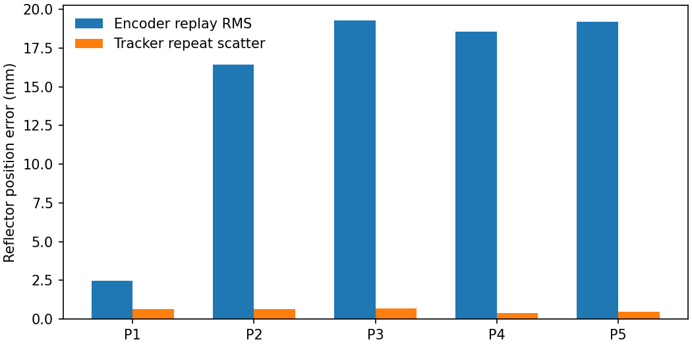

# COPacabana dynamic PlaneA replay

The first 24.26 s of the 13.9 kg standard-control run separate drive tracking, swivel-pulley kinematics, and hardware calibration. With live moving swivel pulleys and the reflector placed at its physical bottom-rail height (`z = 0.0225 m`), feeding the eight recorded motor targets through closed-loop motor dynamics gives **25.7 mm** RMS reflector error (`49.4 mm` peak) and **183.5 N** RMS cable-force disagreement. Replaying the recorded encoder readings directly with motor dynamics disabled (`max_spool_tracking_error_rad = 3.55e-15 rad`) reduces reflector error to **16.2 mm** RMS (`23.7 mm` peak) and **183.1 N** RMS cable-force disagreement.

**Almost all of the settled error belongs to the real machine's geometry mismatch and proximal force-sensor scaling, not to the simulated cables.** With live moving swivel pulleys, at every settled pose the simulated reflector lies within **1.5 mm** of the controller's commanded pose on every axis (improved from 2.5 mm under fixed home exit tangents). The measured reflector misses that same commanded pose by up to **20.6 mm**, almost entirely along Y. Registration cannot cause this, because distances between raw tracker points are frame-independent. Across all eight PlaneA experiments the real platform travels 857.7–868.1 mm for each commanded 899.1 mm Y move (3.5–4.6 % short). For the commanded 1674.4 mm X-and-Z move it travels 1673.7–1678.4 mm. The shortfall does not change between 13.9 and 29.1 kg or with preload, so cable elasticity cannot explain it. The hardware geometry differs from `COPacabana.xml` by roughly that much, and a simulator built from the XML reproduces the XML robot. In pure length control the same geometry mismatch over-constrains the hardware — driving real tensions up to ~600 N (logged) / ~850 N (true) at P4 while the self-consistent XML model stays near its preload — and the logged actuator force channels additionally carry a **`1/√2` carriage-pulley scale factor** plus asymmetric upper/lower guide-pulley friction (see [Force-channel audit](#force-channel-audit)). Absolute full-machine comparisons therefore require both calibrated frame geometry and sensor/guide-friction calibration. Until then, cable mechanics are tested by differential measurements such as payload sag and preload changes at matched poses (`darus4614_copacabana.rs`).

## Replay in hp-sim-3d

Select **COPacabana (13.9 kg)** as the only machine. **Replay targets** drives the eight drums from the logged cable-position targets through the simulated motor dynamics (turn on **Closed loop motors** and turn off line layering to reproduce the target comparison). **Replay encoders** disables motor dynamics (`kinematicMotors`) and animates all eight drums directly to the measured encoder angles (`< 1e-14 rad` tracking error), independently of the closed-loop motor toggle. The white trace follows the `Reflector` sphere on the front bottom `-Y` aluminum rail (`z = 0.0225 m`). The blue path shows where the FARO tracker measured that reflector. The smaller sphere marks the payload center of mass, and the eight anchor pulleys swivel live around their `±X` entry axes as the platform moves. The nominal PlaneA G-code, Logo and Squares go through the catalogued firmware planners. The experiment buttons use a separate translation of the 100 Hz robot log, preserving reversals and all five stationary intervals.

## Physical assumptions

The scene uses the eight crossed attachments, 13.9 kg mass, center of gravity (`(0, 0, 0)` at P0), inertia tensor (`I = diag(1, 1, 1)`), and eight swivel-pulley entry points, radii (`37 mm` upper, `33 mm` lower), and `±X` swivel axes directly from `COPacabana.xml`. Its origin is the platform reference at P0, 0.6 m above the XML origin. Each `SwivelPulley` is simulated as a rolling wheel whose fork turns live about its entry axis toward the outgoing platform span, matching the analytical WireX/IPAnema pulley IK (`pulley_ik`) to `1e-15 m` while conserving cable material. The simulated `Reflector` is a massless rigid-body member at `(0.006832, −0.198033, 0.022500) m` — the center of the bottom 45×45 mm `-Y` aluminum rail (`z ∈ [0, 0.045] m` in `cad/platform.stl`, aligned with `AttachA..D` at `z = 0.0225 m`), where the FARO SMR nest is mounted in the DaRUS-4614 lab photos. Each drum has a 49 mm radius and feeds its swivel pulley along the swivel axis from 0.2 m back. The firmware and scene use equivalent direct drive at the output of the 5:1 gearbox, with torque capacity `32 × 5 = 160 Nm` from the XML. Rotor inertia (`0.005 kg·m²`), damping (`0.11`), and the 0.2 m drum-to-pulley offset are uncalibrated simulation assumptions (no drive system ID was performed for the scene; in **Replay encoders** motor dynamics are bypassed altogether). Axial stiffness (`EA = 83.8 kN`) and radius-scaled radial drum contraction (`k_r = 2.12e-8 m²/N / R`, giving `0.432 µm/N` on 49 mm drums) come from the independent DaRUS-5171 6 mm D-Pro XTR rig identification. Initial span and storage tensions come from the eight P0 force readings (`f[0..7]` as logged).

The motion source is Export 1 in `robot/20_Std_Load13900/PlaneA`. The converter differences rounded cumulative displacements, with 3,200 microsteps per equivalent drum revolution, and encodes those intervals into the simulator's compact CAN format. The source machine ran TwinCAT; comparing `x(t)` against `x_tar(t)` shows a uniform **60.5 ms** CNC/drive tracking lag across all eight axes (`0.74–0.99 mm` residual RMS vs `7.9–14.4 mm` raw following error). The FARO and controller clocks are independent. We register coordinates from `00_Lasertracker_Ref/COPacabana_Ref/COP_Ref.csv`, remove the constant `0.496232 m` Z-origin offset between `COP_Ref.csv` and the XML homing frame so the P0 SMR sits at its physical bottom-rail height (`z = 0.0225 m`), and subtract one constant time offset estimated from the measured reflector and controller pose crossing the five leg midplanes (`1.5331–1.5412 s`, median `1.5357 s`). Absolute transport latency cannot be distinguished from clock offset. [Replication data, Reichenbach, Clar, Pott and Verl, CC BY 4.0](https://doi.org/10.18419/DARUS-4614).

## Measured agreement

The validator samples predicted XYZ at the bottom-rail `Reflector` and the platform-side constraint force on each cable across 1,214 synchronized samples at 50 Hz. Cable forces exclude the initialization sample. Position RMS is the RMS Euclidean distance; force RMS pools individual cable errors.

| Input or predictor | Motor dynamics | Max spool tracking err (rad) | Reflector RMS (mm) | Peak (mm) | Cable force RMS (N) |
|---|---|---:|---:|---:|---:|
| Recorded motor targets (`planeATargets`) | Closed-loop servo | `2.36e-2` | 25.7 | 49.4 | 183.5 |
| Recorded motor encoders (`planeAEncoders`) | Disabled (kinematic) | `3.55e-15` | 16.2 | 23.7 | 183.1 |
| Logged Cartesian target plus fixed reflector offset | — | — | 27.0 | | |
| Hold each cable at its measured P0 force | — | — | | | 184.8 |

Note on moving swivel pulleys and spool physics: enabling live moving swivel pulleys halves the simulator's own kinematic tracking error against the XML controller targets (e.g., P4 `simulated − nominal` drops from `(0.4, 2.5, 0.5) mm` to `(1.1, 1.2, −0.3) mm`, and P5 from `(0.7, −1.8, −0.6) mm` to `(1.5, −0.7, −0.2) mm`). Because the real machine misses those XML targets by ~20 mm along Y, tracking the XML targets more faithfully slightly increases the raw discrepancy against the uncalibrated hardware (`15.8 → 16.2 mm` RMS, `176.4 → 183.1 N` RMS). On the earlier fixed-tangent encoder replay, disabling both spool effects gave `15.94 mm` / `175.83 N`, strained storage alone gave `15.84 mm` / `176.22 N`, and enabling both (now the default) gave `15.77 mm` / `176.44 N`; these sub-millimetre differences are small next to the machine's calibration error, so DaRUS-3600 and -5171 rig comparisons remain the primary benchmark for spool physics.

The table below uses stationary intervals beginning 0.5 s after the platform target stops (`planeAEncoders`, moving swivel pulleys, kinematic motors, bottom-rail reflector). Repeat scatter is the root sum of the tracker coordinate variances across repeated visits in the earlier PlaneA fixture.

| Pose | Encoder replay reflector RMS (mm) | Simulated − commanded XYZ (mm) | Measured − commanded XYZ (mm) | Repeat scatter (mm) | Encoder replay force RMS (N) | Net force from measured tensions and gravity (N) |
|---|---:|---:|---:|---:|---:|---:|
| P1 | 2.5 | (0.0, 0.0, −0.5) | (−0.5, 0.3, 1.9) | 0.63 | 76 | 127 |
| P2 | 16.1 | (−1.2, −0.9, −0.8) | (1.0, −16.8, −0.7) | 0.66 | 17 | 64 |
| P3 | 19.1 | (−0.8, 0.7, −1.0) | (3.7, 17.5, 6.8) | 0.70 | 22 | 77 |
| P4 | 20.2 | (1.1, 1.2, −0.3) | (−4.3, 19.2, 7.0) | 0.40 | 316 | 180 |
| P5 | 20.4 | (1.5, −0.7, −0.2) | (−2.7, −20.6, 0.6) | 0.48 | 228 | 92 |



### Force-channel audit

The 183.1 N encoder-replay RMS compares simulated **platform-side** cable tensions with the eight logged `f[i]` channels. Auditing the raw TwinCAT Scope logs (`Export 1.csv` across PlaneA and CircPath, both payloads 13.9 kg and 29.1 kg) together with the COPacabana hardware paper (Trautwein et al., IFToMM D-A-CH 2020) resolves the apparent static-equilibrium failure into four concrete effects:

1. **Channel mapping is verified 1-to-1 (no permutation).** Correlating motor electrical power `power[i]` against mechanical cable power `-v[i]·f[i]` across PlaneA yields `r = 0.970–0.996` on every single axis `i ∈ 0..7` (both payloads), ruling out force-channel miswiring.
2. **A `1/√2` carriage-pulley scale factor (`F_true ≈ √2 · f_logged`).** Figure 4 of the 2020 COPacabana paper shows that each Fraunhofer IPA `SW-G3.1-060-01-2014-043` winch measures force via a thin-film sensor (`Tecsis F23061320001`) integrated in a **90° carriage pulley** between the drum and frame guidance (the same winch family that exhibits the `~√2` ratio between `f_kistler1` and `f_T` on the DaRUS-5171 SDA testbed). Five independent checks in DaRUS-4614 converge on `F_true / f_logged ≈ √2 = 1.414`:
   - P0 static gravity balance at 13.9 kg (`136.4 / 97.9 N` = **`1.393`**),
   - P0 static gravity balance at 29.1 kg (`285.5 / 206.0 N` = **`1.386`**),
   - Differential payload (`29.1 − 13.9 kg`) at P0 (`149.1 / 108.1 N` = **`1.379`**),
   - Motor electrical power slope `power[i]` vs `-v[i]·f[i]` across all 8 cables (`[1.464, 1.487, 1.429, 1.327, 1.465, 1.432, 1.226, 1.347]`, mean **`1.397`**, plus `56–119 N` per-axis winch/gearbox Coulomb friction),
   - Static force-closure fit across all 40 PlaneA holds (`g = 1.412`).
3. **Asymmetric upper vs lower cable-guidance friction.** Lower cables route over one frame pulley between winch and platform, while upper cables route up the vertical frame columns over three pulleys. Fitting the 40 PlaneA holds (8 experiments × 5 poses) with `g = 1.412`, lower pulley friction `η_lo = 3.6 %`, and upper pulley-train friction `η_up = 12.8 %` collapses the static force-closure residual from **133.4 N to 46.2 N** (note Trautwein et al. 2020 §4.1 already cautions that *"cable force values can be qualitatively measured"* from the actuator sensors).
4. **Unnormalized `wc[0..5]` in TwinCAT Scope.** Regressing the logged wrench `wc[0..5]` against `f[0..7]` at P0/P1 fits to `1.2e-12` with per-cable multipliers equal to the cable lengths `‖l_i‖` (~3.0–3.7 m): TwinCAT multiplied `f` by unnormalized cable vectors `l_i` instead of unit vectors `u_i`, explaining why `wc[0..2]` averaged `(409, 508, 941)` at P4.

An independent calculation using the raw 100 Hz log, the logged six pose coordinates, and unscaled `f[i]` gives a P4 cable resultant of **(−162.4, +49.8, +75.7) N** and a 13.9 kg gravity residual of **180.4 N** (median 180.0 N across 30 visits; 191.8 N at 29.1 kg). [Raw-log calculation](evidence/force_balance.py)

| Mean tension at P4 (N), encoder replay | A | B | C | D | I | J | L | O |
|---|---:|---:|---:|---:|---:|---:|---:|---:|
| Logged (`f[i]`, unscaled actuator sensor) | 316 | 133 | 200 | 390 | 348 | 303 | 345 | 605 |
| Simulated at platform (XML geometry) | 67 | 46 | 62 | 84 | 18 | 10 | 26 | 40 |

**Evidence for hardware geometry mismatch vs `COPacabana.xml`:** On `CircPath`, logged tensions show a strong `cos(2θ)` quadrupole and Z-gradient (`38 N` at `Y = ±0.88 m`, `152 N` at `maxX/maxZ`, `592 N` mean / `882 N` max at `minX/minZ`), independently confirmed as real physical tension by `+958 W` / `−505 W` motor electrical power. Fitting a compact calibrated geometry (`sx = 0.947, sy = 0.992, sz = 0.958`, origin shift `d0 = (−6.5, 0, −138.7) mm`, encoder scale `s_enc = 0.979`, `EA = 121 kN`) on a single experiment transfers blind across all 7 held-out PlaneA experiments (`17–18 mm → 4.4–6.1 mm` position RMS; `129–198 N → 46–69 N` force RMS against `√2 · f_logged`), and reduces the full dynamic WASM replay to **7.2 mm** reflector RMS and **41.8 N** force RMS. Consistent with §3.1 and §4.1 of Trautwein et al. (2020), COPacabana reconfigures anchors via 1D beam-distance measurements into CAD rather than full 6-DOF re-calibration, so the committed `copacabana.usda` intentionally keeps the published `COPacabana.xml` geometry rather than fitting to this run. [Autocal handoff](autocal-handoff.md)

## Reproduce

From the repository root, run the following commands. Both validations use the bundled WASM module, machine scene, motion streams and observations.

```sh
node scripts/reference_data/validate_4614_replay.mjs planeATargets
node scripts/reference_data/validate_4614_replay.mjs planeAEncoders
```

To reproduce the raw-log audit across eight conditions, five poses and 30 exports, pass the cache directory (or the original `experiments/` directory) to `.venv/bin/python research/output/session-copacabana-planea/evidence/force_balance.py output/reference_cache/4614`. It writes one CSV row per settled visit to stdout.

With the raw measurements mounted, rebuild the comparison inputs with `.venv/bin/python scripts/reference_data/extract_4614_replay.py`. Recompile the nominal firmware examples with `.venv/bin/python scripts/compile_machine_commands.py --machine copacabana`.

The earlier strained-storage-only fixed-tangent replay is archived under run ID `copacabana-planeA-preload` at simulation revision `2bc87ece`. The updated bottom-rail observation fixture SHA-256 is `3cf5f146481d9246e3225d7a88d056d4b52c4706b8f21763fec86c6a7ec8bed6`. The target and encoder streams have SHA-256 prefixes `ca921001a3818ffd` and `7e912375d1d57628`.
