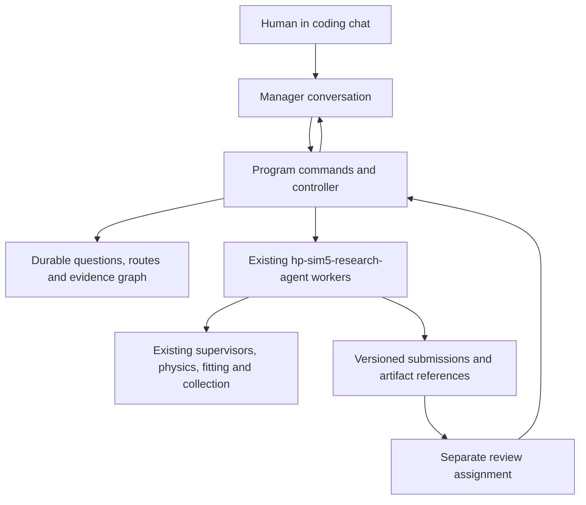

# Research manager: implementation contract

Accepted direction, 2026-10-23. This defines the manager release implemented by
tasks 007–016. Tasks 001–006 delivered useful foundations; they did not implement
this release. The [original design](../../research-program-design.md) supplies
background. This contract and current human steering govern the new backlog.

## The user experience to deliver

In a repository-connected coding chat such as Codex or Claude Code, the human
supplies a research question and optional constraints. The chat agent assumes
the **manager** role, creates or resumes a durable program, develops competing
approaches, and delegates bounded investigations to the existing
`hp-sim5-research-agent`. It incorporates reviewed results, revises priorities,
and reports what is known, uncertain, promising, parked or retired and why.

The human can say “continue”, “why this approach?”, “what supports that?”,
“try this idea”, “stop that worker”, “pause”, “resume” or “stop the program”.
They need not operate a work board, prepare worker prompts or reconstruct logs.
The same program can outlive a chat, and another manager can reconstruct it.

Required entry routes:

1. An existing repository-connected chat can start and operate the program through
   the saved manager prompt and CLI tools available to that chat. This route must
   work without opening a second terminal or manually attaching a server first.
2. A dedicated `hp-sim5-research-program --codex` or `--claude` opens the manager
   in an existing supported coding-client chat; `--serve` supplies MCP attachment
   configuration for clients supporting it. Share the existing client/auth
   integration where practical. No custom web chat or additional model API is
   required. Plain chat without repository/tool access has no execution powers.

The names and arguments below are target interfaces until their owning tasks
ship; current single-agent research prompting remains usable meanwhile.

## Ownership and reuse

- The manager reasons about strategy. Ordinary controller code owns state
  transitions, dispatch, reservations, reconciliation and stop behavior.
- Workers continue using `hp-sim5-research-agent --batch`, its worktree and session
  conventions, native/RRF tools and recorder lifecycle. Preserve interactive
  worker access. Do not create another physics runtime or change worker defaults
  to build this layer. A manager conversation itself needs no physics world.
- A reviewer gets a fixed claim, candidate and evidence, independently of the
  producing worker's verdict. Existing evidence-first review applies: rerun only
  to resolve a named gap. Findings, execution outcome and code readiness remain
  separate. An accepted CLI exit is never scientific acceptance.
- A bounded manager run orchestrates distinct assignments. It must not restart
  the same unfinished conversation repeatedly as a continuation mechanism.

## Durable program memory and queryable graph

Use ordinary Python and a small local store with transactional updates, stable
IDs, schema versions and readable exports. SQLite is an appropriate default;
another compact design must demonstrate equivalent concurrency/recovery behavior.
Keep artifacts in the existing research/session layout and reference their hashes.
Do not ingest every telemetry sample or require a graph database/vector service.

Represent the human goal/constraints, questions, approaches, scoped claims,
artifacts, alternative derivations, assessments, assignments, attempts, steering
and dated decisions. Distinguish simulated, synthetic, analytic and hardware
evidence; speculative/imported claims remain unreviewed until assessed.

Support typed relations for provenance, premises, support, challenge, scope
limits, supersession and route decisions. Enforce acyclic required-premise
dependencies, while permitting cycles in evidential discussion. Record AND
premises inside one derivation and alternative sufficient derivations separately.
Withdrawal queues affected conclusions for review; a surviving valid derivation
can retain support. A new simulator revision marks new applicability unestablished
without erasing old measurements. Shared datasets/source prevent false claims
of independent confirmation.

The manager must answer from durable records, with citations:

- What do we know and not know about this question, in which configurations?
- Which approaches are live, promising, parked or retired, and why?
- What supports/challenges a claim or prioritization, and what used that claim?
- What changes if a measurement is withdrawn or a relevant input changes?
- What observation would distinguish the remaining explanations most cheaply?

## Strategy, execution and review

Use an approach board with explicit continuation, promotion, parking, retirement
and reopening reasons. Novelty, expected decision value, uncertainty and estimated
cost guide allocation; a single opaque promise score is insufficient. Failure of
an experiment or implementation does not by itself falsify its research idea.
Different routes can have useful tradeoffs. Keep them visible without replaying
exhausted methods unless inputs, scope or hypothesis change.

The manager can commission bounded evidence/literature scouting as well as
experiments and tooling work. Preserve human notes, URLs and hunches with their
provenance; an idea can steer work without becoming an empirical fact. Ordinary
explicit steering takes effect within the current authority, without repeated
permission requests. A charter change or larger allocation is recorded explicitly.

Fresh fits, headless/native physics and simulated collection are allowed by
default. When the human supplies no caps, choose and record finite targeted
allocations from workload costs. Use supported `--speedup` settings (normally
`--speedup 25` for simulated autocal CLI), headless native Rust and suitable
recording modes. Preserve simulation clocks, physical scope and delivery gates.
The development queue's budgets are separate from each runtime program's limits.

Controller code enforces dispatch/concurrency, reservations, review backlog,
wall deadlines and owned-process lifecycle. Use existing supervisor/tool limits
for physical workload. Distinguish measured use, worker-reported use, estimates
and enforceable caps; unmetered shell work cannot be advertised as a hard movement
or spend guarantee. Reserve review/cleanup capacity, and stop at the actual
supported boundary. Budget exhaustion or tool failure is not a negative hypothesis.

Keep submitted evidence versions and assessment history. Worker output cannot
directly mark a claim accepted. Reviewer identity, contract, exact evidence and
checks accompany each admission. Same-user worktrees and shared output are not
adversarial isolation: document and test the actual boundary. Stronger protected
evaluation is additional deployment work; never claim it from file hashes alone.

Use isolated worker worktrees/worlds with a default of one active worker and a
small configurable parallel pool. A patch stays a candidate until explicit
integration prepares a combined candidate and its relevant checks pass. The
manager must not automatically push/merge research patches into the human's branch.

## Completion and verification

Each task delivers running behavior and focused checks, not another specification
or prompt-only approximation of its required functionality. Early tests can use
small fixtures and fake children, but task 016 must demonstrate the real chat →
manager/controller → existing launcher → production tool → review → graph →
replanning path, plus controlled interruption and fresh-chat recovery.

The final pilot uses at least two completed managed investigations, including
one real bounded production physics/fitting/collection operation and a useful
negative/inconclusive route decision. It also demonstrates an explicit graph
query and evidence-withdrawal case, steering and clean stopping. Test parallel
coordination and combined-patch checks at their appropriate fixture level; do
not run duplicate expensive physical trials merely for review independence.

Release readiness requires every task 007–016 accepted, passing relevant checks,
documented current commands and the live pilot evidence. Missing runtime/client
access is a genuine block on the live milestone, not permission to substitute a
mock and declare the manager finished. Scientific questions may remain open.
The release is this complete local manager capability; cloud deployment, a new
chat UI, unlimited unattended research and guaranteed scientific discoveries are
outside its scope.
