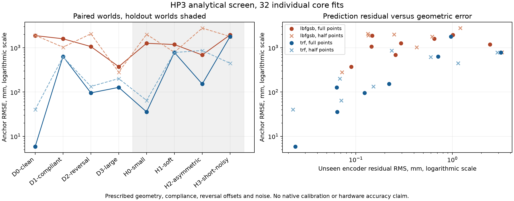

# HP3 autocal robustness across parameter variation

Status: bounded investigation complete; program paused.

## Abstract

This program investigated encoder-only HP3 calibration across varied parameter assumptions. A bounded analytical benchmark evaluated eight frozen worlds with 32 core fits in 118.24 seconds. Only six fits passed complete status and coverage checks. In one complete-coverage case, lower unseen residual accompanied anchor RMSE worsening from 5.89 to 40.20 mm after thinning. Two native stiffness worlds then each collected 60 bootstrap points, taking 75.02 measured world seconds together. Their poor conventional scene-home estimates and identical raw/geometry-metadata-stripped fits did not justify solver, point-count or stopping changes. Separate reviewers verified both scoped findings and marked both tools ready. A cloud review path bug was fixed; unsourced Node 24 crashes were corrected with pinned Node 23 and a pre-movement guard. Platform model limits interrupted one worker narrative, but saved measurements and deadline cleanup survived. No reliable fewer-point calibration gain or direct reference-003 win was established.

## Results and decisions

The retained changes are an analytical parameter benchmark, a bounded native HP3 stiffness collection helper and a cloud review path repair. All use existing production physics and fitting code. Production calibration defaults and one-click stopping are unchanged.

The analytical study compares lbfgsb/trf and full/half stored point density across eight predeclared worlds. Its common-unseen residual reverses the geometry ranking in 17 candidate pairs. A clean, complete-coverage TRF example improves residual from 0.02362 to 0.02234 mm while anchor RMSE rises from 5.885 to 40.203 mm. Half density also has large per-world regressions. The independent review recomputed all saved inputs, seeds, RMSEs and residuals, and kept candidate cc52307f with ready code. These are individual cold core fits, not complete-loop failures.

The native study collected three 20-point sweeps per world at stiffness 20000/8000 N, fixed 30 mm radii, zero buildup and no layering. Requested collector settings match; realized drive spans differ, 94.106 versus about 234.918 mm. Total work was 602454 steps and 75.023 measured world seconds, with no recording. These single-run totals are not an equivalent-work full-autocal speedup. Four raw fits and four geometry-metadata-stripped fits have exactly identical anchors, metrics and optimizer histories. Conventional scene-home RMSE is 2023/2003 mm nominal and 3648/2676 mm soft for lbfgsb/trf. Unknown encoder-zero pose/rotation and omitted full-loop stages limit physical interpretation. The reviewer kept the scoped findings and helper a4da0d73, ready with no required checks.

## Cloud faults and remedies

The default review store uses .research-programs/reviews, but the cloud bridge initially allowed final messages only under output. The first launch stopped before model dispatch. Commit ae0b20c4 adds a narrow repository-contained reviewer-path allowance. The failing regression and 51 passing transport/controller checks are retained. Two real separate reviews subsequently completed through this path.

Two standalone native launches inherited Node 24.19.0 and aborted before completing a physics update. Their supervisor had correctly used pinned Node 23, which does not transfer to independent command shells. Sourcing scripts/cloud/env.sh and verifying Node 23.11.1 enabled both replacement collections. The retained helper rejects unsupported Node before creating output or moving physics. Both original failures remain evidence.

A model-capacity interruption was recovered in the same first worker. A later usage limit prevented the second worker's final narrative. Its owner enforced the original 09:01 UTC deadline and confirmed cleanup. The manager explicitly authored the saved-data closure after the user's continue message, without fabricating a worker response or running further fitting/simulation. All actor cancellation and review acknowledgements used actual lifecycle observations.

## Implementation and checks

- cc52307f adds the analytical benchmark and tests. 64 solver/stage/benchmark checks passed.
- ae0b20c4 fixes cloud review response paths. 51 transport/review-controller checks passed, followed by real review completion.
- a4da0d73 adds the native collector helper, runtime guard and tests. 19 focused tests passed. The reviewer repeated them and checked additional mocked failure/timeout/cleanup paths.

These counts overlap and should not be summed as a unique-test total. No engine, motor, cable-transport or production-scene implementation changed. The native delivery helper was checked against the measured driver and with mocks, without another native collection.

## Review and remaining questions

Both fixed submissions received supported/keep admissions and ready code, with no required follow-up checks. [First review](review-first.json) and [native review](review-native.json) preserve exact claim, submission and revision identities.

The requested reference-003 raw directory is absent. No direct win over it is claimed. Hardware transfer, robust fewer-point stopping, automatic force tuning across physical worlds and full-loop native calibration remain untested here. The next recorded question asks whether automatic force tuning and additional independent sweeps repair bootstrap estimation. No numerical allocation remains active.

## Evidence and references

- [First worker report](../attempt-3b2e360ec1834eee9bab4e06f6f880fd/report.md), [first exact review](review-first.json).
- [Manager native report](native-report.md), [native summary](native-saved-summary.json), [exact native review](review-native.json).
- [Cloud issue record](cloud-environment-issues.json), [cloud repair checks](cloud-review-path-after.log), [native helper checks](native-helper-checks.log).
- [Notebook](research.md), [literature note](literature.md), [reference search](reference-search.json).

Program: program-3858dd28150847d492a61ea2345f9d08. Its archive preserves fixed submissions and selected small evidence; files.json records omissions.
